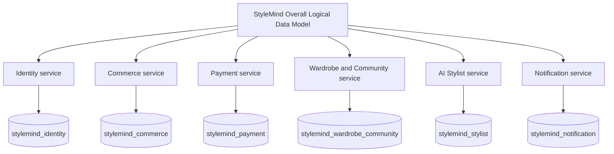
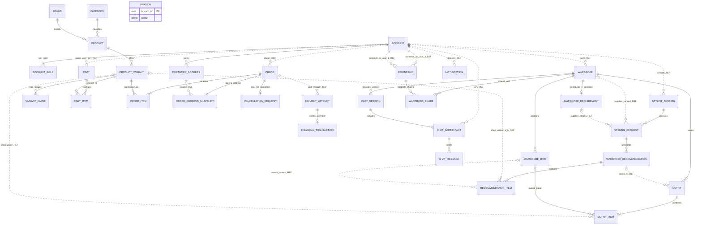
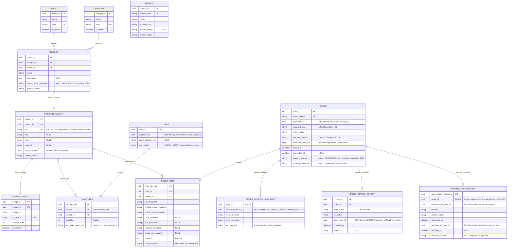
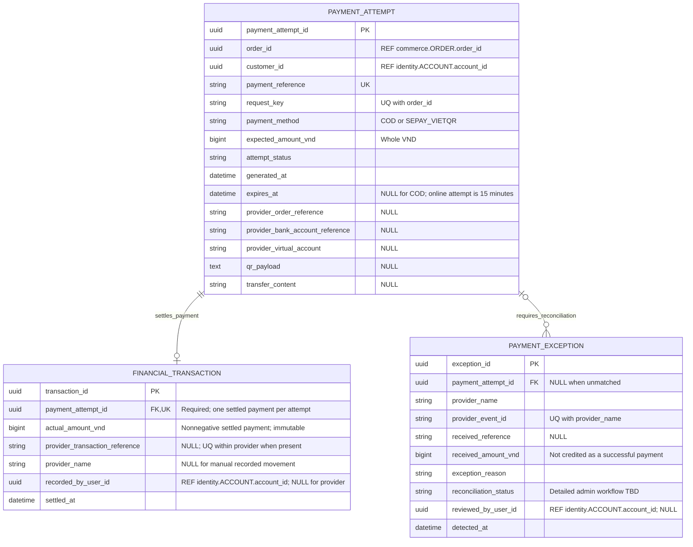
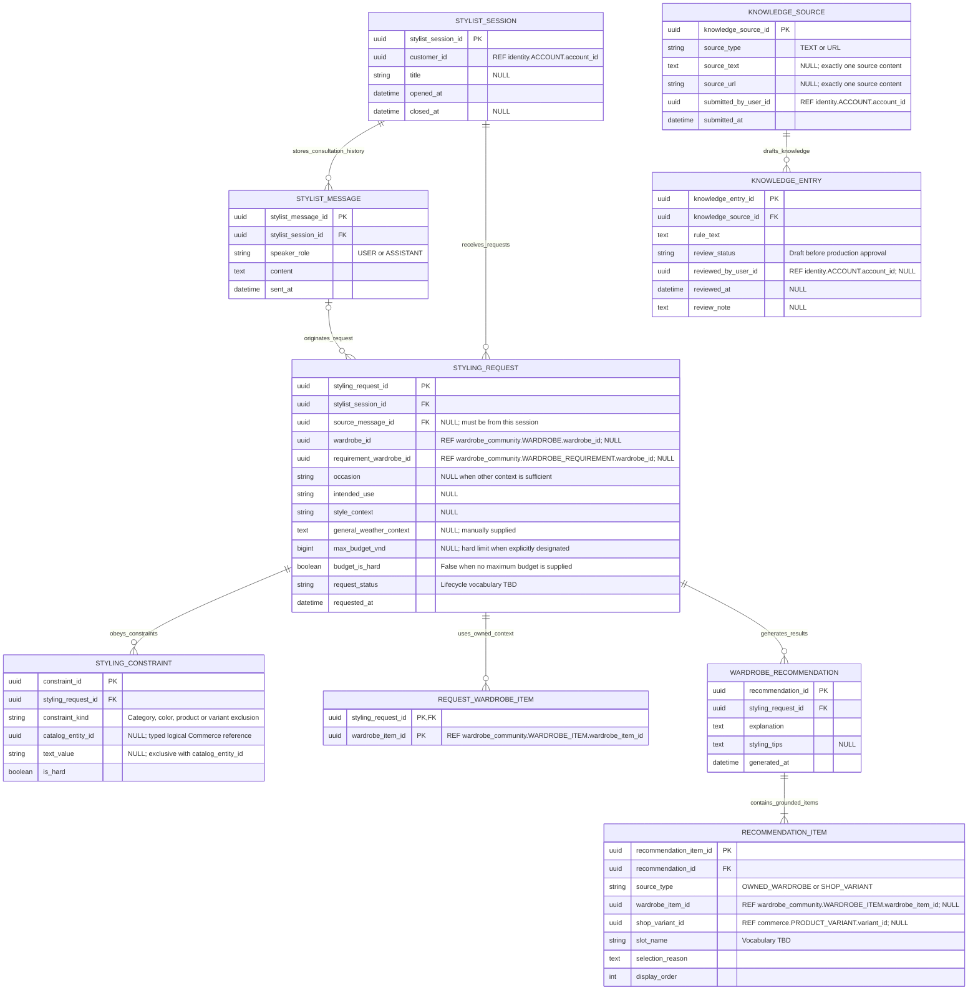
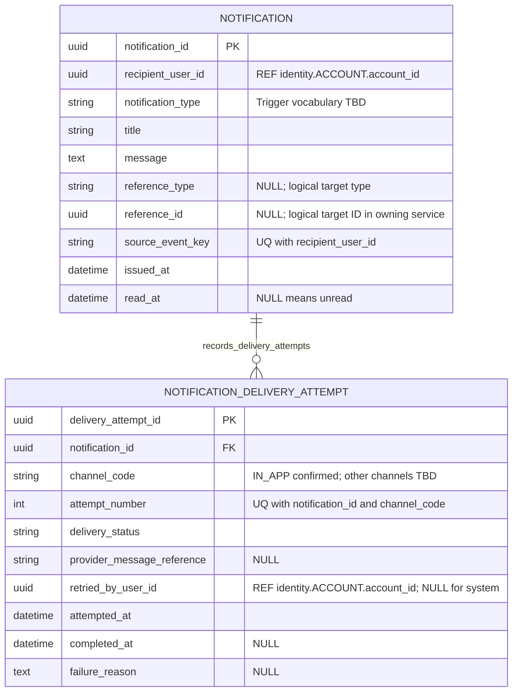

# StyleMind Databases for Six Services

Ngày đối soát: 2026-10-08.

Đây là target logical model cho sáu service hiện hành. Tổng cộng có 48 bảng logical. Trong đó, Identity có 11 bảng vật lý được tạo bởi V1–V3; 37 bảng ở năm service còn lại là mô hình đích và CHƯA được migrate thành business schema. Không tính `flyway_schema_history` vào số bảng nghiệp vụ. Việc local Compose tạo sáu logical database không có nghĩa là các service ngoài Identity đã có business tables.

Mapping hiện hành do chủ dự án chốt: Commerce gộp Catalog, Cart, Checkout và Order; Wardrobe and Community gồm cả chia sẻ/community. Không khôi phục service Catalog/Cart/Checkout riêng, Social service, stock/inventory, reservation, return, refund, QC hoặc restock. BRANCH và CANCELLATION_REQUEST vẫn thuộc model; xử lý cancellation/payment exception còn TBD. Production topology chưa được quyết định.

Tài liệu này mô tả logical ownership và không thay thế physical schema. Dùng sáu source Mermaid bên dưới cho target model; dùng các migration đã version hóa làm physical truth. Tài liệu cũ trong [legacy archive](../../docs/archive/legacy-baseline/20261008T0855Z/README.md) chỉ là lịch sử, không phải execution baseline.

## Phạm vi hiện hành

Mô hình sáu service và phạm vi đã chốt được ghi trong [current project context](../../docs/governance/CURRENT_PROJECT_CONTEXT.md). Không có bảng stock/inventory/reservation, return, refund, QC hoặc restock trong target model này. Branch và Cancellation Request được giữ; không tự suy ra fulfillment policy, hủy đơn đã thu tiền, hay cách xử lý payment exception.

Các PRD/SAD/DEC và review cũ được bảo toàn trong archive để truy vết, nhưng không còn là implementation baseline nếu mâu thuẫn với hướng dẫn hiện hành. Archive không sửa/đóng các identifier OPEN/DR/DEC.

## Quy ước

PK là primary key; FK là foreign key chỉ trong cùng database; UK là unique key đơn cột. Composite uniqueness được ghi bằng comment UQ with, không đánh dấu nhầm từng thành phần là unique riêng. Cột có comment NULL là nullable, các cột khác được đề xuất Not Null. Types uuid/string/text/int/bigint/decimal/boolean/datetime là logical types, chưa xác định SQL widths hay chuẩn time zone.

Comment REF service.TABLE.attribute là ID tham chiếu logic tới service khác. Nó không có FK vật lý xuyên database. Trong system view, những liên kết này có nhãn REF; các ERD database chỉ vẽ quan hệ local. Với kiểu UNIQUE nullable, semantics PostgreSQL cần được chốt đúng khi xuống DDL.

Các thực thể ở năm service ngoài Identity là target logical model, chưa phải physical schema. Nhãn CONFIRMED dùng cho quyết định chủ dự án đã nêu trực tiếp; OBSERVED dùng cho source, migration, test hoặc audit evidence; PROPOSED chỉ là lựa chọn thiết kế chưa duyệt; TBD là rule/contract còn thiếu. Migration xác định schema vật lý, còn source/test không tự phê duyệt business behavior.

## Phân chia database

| Service | Database | Số bảng logical | Trạng thái physical schema | Mermaid |
| --- | --- | ---: | --- | --- |
| Identity | `stylemind_identity` | 11 | Physical schema from V1–V3 | [01_identity.mmd](01_identity.mmd) |
| Commerce | `stylemind_commerce` | 13 | TARGET LOGICAL MODEL / NOT YET MIGRATED | [02_commerce.mmd](02_commerce.mmd) |
| Payment | `stylemind_payment` | 3 | TARGET LOGICAL MODEL / NOT YET MIGRATED | [03_payment.mmd](03_payment.mmd) |
| Wardrobe and Community | `stylemind_wardrobe_community` | 10 | TARGET LOGICAL MODEL / NOT YET MIGRATED | [04_wardrobe_community.mmd](04_wardrobe_community.mmd) |
| AI Stylist | `stylemind_stylist` | 9 | TARGET LOGICAL MODEL / NOT YET MIGRATED | [05_stylist.mmd](05_stylist.mmd) |
| Notification | `stylemind_notification` | 2 | TARGET LOGICAL MODEL / NOT YET MIGRATED | [06_notification.mmd](06_notification.mmd) |

The local `stylemind_*` databases may be provisioned by Compose before these schemas exist. Identity's V1–V3 history was last verified successful against persistent local `stylemind_identity` in the cited audit; no database connection or migration was run for this reconciliation.

## Đối chiếu thực thể tổng với chủ sở hữu

| Khái niệm từ CDM hoặc requirement | Logical tables | Data owner | Ý nghĩa của việc phân chia |
| --- | --- | --- | --- |
| Customer và Admin | ACCOUNT, ACCOUNT_ROLE | Identity | Hai vai trò dùng chung cơ chế tài khoản; AI Stylist là thành phần hệ thống. |
| Address | CUSTOMER_ADDRESS | Identity | Địa chỉ hiện hành của khách hàng. |
| Category và Brand | CATEGORY, BRAND | Commerce | Phân loại và thương hiệu của hàng shop. |
| Product | PRODUCT | Commerce | Nội dung sản phẩm ở cấp chung. |
| Product Variant | PRODUCT_VARIANT | Commerce | Lựa chọn mua thực tế: SKU, size, màu, chất liệu, giá. |
| Variant Image | VARIANT_IMAGE | Commerce | Gallery gắn với biến thể. |
| Branch | BRANCH | Commerce | Danh mục chi nhánh; không quản lý tồn kho hay tự suy ra phân bổ đơn. |
| Cart và Cart Item | CART, CART_ITEM | Commerce | Có giỏ Guest/User; price cache không khóa giá. |
| Order | ORDER, ORDER_STATUS_HISTORY | Commerce | Đơn hàng và lịch sử vòng đời. |
| Order Address Snapshot | ORDER_ADDRESS_SNAPSHOT | Commerce | Địa chỉ/nguời nhận bất biến tại lúc mua, 1:1 với Order. |
| Order Item | ORDER_ITEM | Commerce | Số lượng và snapshot SKU/tên/giá/đặc tính mua. |
| Cancellation Request | CANCELLATION_REQUEST | Commerce | Yêu cầu hủy cả đơn; xử lý đơn đã thu tiền là TBD trong phạm vi không refund. |
| Transaction | PAYMENT_ATTEMPT, FINANCIAL_TRANSACTION | Payment | Lần thử thanh toán và tiền thanh toán đã quyết toán; không có refund. |
| Wardrobe và Wardrobe Item | WARDROBE, WARDROBE_ITEM | Wardrobe and Community | Dữ liệu quần áo đã sở hữu, độc lập với hàng đang bán. |
| Wardrobe Requirement | WARDROBE_REQUIREMENT | Wardrobe and Community | Giữ khái niệm từ CDM; lưu thành profile theo tủ vẫn là PROPOSED. |
| Outfit | OUTFIT, OUTFIT_ITEM | Wardrobe and Community | Bộ phối được khách lưu trong tủ; khác kết quả AI chưa lưu. |
| Wardrobe Recommendation | WARDROBE_RECOMMENDATION, RECOMMENDATION_ITEM | AI Stylist | Kết quả sinh từ yêu cầu phối đồ. |
| Chat Session với bạn bè | CHAT_SESSION, CHAT_PARTICIPANT, CHAT_MESSAGE | Wardrobe and Community | Có context tủ đồ và người tham gia cụ thể. |
| Chia sẻ tủ đồ/bạn bè | WARDROBE_SHARE, FRIENDSHIP | Wardrobe and Community | Ghi quyền được chia sẻ và quan hệ bạn bè. |
| Tư vấn AI | STYLIST_SESSION, STYLIST_MESSAGE, STYLING_REQUEST | AI Stylist | Lịch sử tư vấn khác hội thoại giữa khách hàng. |
| Notification | NOTIFICATION, NOTIFICATION_DELIVERY_ATTEMPT | Notification | Hộp thư, trạng thái đọc và bằng chứng gửi/thử lại. |
| Hồ sơ phong cách từ prototype | STYLE_PROFILE, PROFILE_STYLE, PROFILE_COLOR, PROFILE_BRAND | Identity | Đề xuất lưu theo khách hàng; không đồng nhất với tiêu chí theo tủ. |
| Duyệt tri thức từ text/URL | KNOWLEDGE_SOURCE, KNOWLEDGE_ENTRY | AI Stylist | PRD-ADM-004 xác nhận capability; bảng cụ thể là PROPOSED. |

## Quan hệ tổng của hệ thống

Sơ đồ này thể hiện các liên kết nghiệp vụ chính giữa database. Đây là system relationship overview; attributes đầy đủ và các quan hệ còn lại có ở từng ERD bên dưới. Không triển khai overview thành một database dùng chung.

## Identity Database

Database: `stylemind_identity`. Source Mermaid: [01_identity.mmd](01_identity.mmd). This physical schema view reflects nine V1 tables plus one V2 and one V3 challenge table. The previous rendered snapshot omitted the challenge tables and is archived; no Mermaid renderer is installed to generate a replacement.

```mermaid
erDiagram
    %% Current physical Identity view mapped from V1-V3. NULL is stated in comments.
    %% Customer and Admin are ACCOUNT roles, not duplicate account tables.
    %% V1 tables are followed by the V2/V3 challenge tables below.
    %% V2/V3 CHECK constraints remain in their migrations; this ERD does not expand them into attributes.
    ACCOUNT {
        uuid account_id PK
        string email UK
        string password_hash
        string account_status
        datetime email_verified_at "NULL"
        datetime registered_at
    }
    ACCOUNT_ROLE {
        uuid account_id PK, FK
        string role_code PK "CUSTOMER or ADMIN"
    }
    USER_PROFILE {
        uuid account_id PK, FK
        string display_name
    }
    CUSTOMER_ADDRESS {
        uuid address_id PK
        uuid account_id FK
        string label "NULL"
        string recipient_name
        string recipient_phone
        string address_line
        string ward_code "NULL; external Vietnam directory code"
        boolean is_default
    }
    STYLE_PROFILE {
        uuid account_id PK, FK
        string fit_preference "NULL"
        decimal height_cm "NULL"
        string usual_top_size "NULL"
        string usual_bottom_size "NULL"
        string shoe_size "NULL"
    }
    PROFILE_STYLE {
        uuid account_id PK, FK
        string style_code PK "Vocabulary TBD"
    }
    PROFILE_COLOR {
        uuid account_id PK, FK
        string color_code PK "Vocabulary TBD"
    }
    PROFILE_BRAND {
        uuid account_id PK, FK
        uuid brand_id PK "REF commerce.BRAND.brand_id"
    }
    REFRESH_SESSION {
        uuid session_id PK
        uuid account_id FK
        string token_hash UK
        datetime issued_at
        datetime expires_at
        datetime revoked_at "NULL"
    }
    EMAIL_VERIFICATION_CHALLENGE {
        uuid challenge_id PK
        uuid account_id FK, UK
        bytes code_digest "32 bytes"
        datetime expires_at
        smallint failed_attempts "DEFAULT 0; CHECK 0..5"
        datetime consumed_at "NULL"
        datetime last_send_attempt_at
        datetime send_window_started_at
        smallint send_count "CHECK 1..3"
        datetime locked_until "NULL; CHECK with failed_attempts"
    }
    PASSWORD_RESET_CHALLENGE {
        uuid challenge_id PK
        uuid account_id FK, UK
        bytes otp_digest "32 bytes"
        datetime otp_expires_at
        smallint failed_attempts "DEFAULT 0; CHECK 0..5"
        datetime locked_until "NULL; CHECK with failed_attempts"
        datetime last_send_attempt_at
        datetime send_window_started_at
        smallint send_count "CHECK 1..3"
        datetime verified_at "NULL"
        bytes reset_token_hash "NULL, UK, 32 bytes"
        datetime reset_token_expires_at "NULL"
        datetime consumed_at "NULL"
    }

    ACCOUNT ||--|{ ACCOUNT_ROLE : has_roles
    ACCOUNT ||--o| USER_PROFILE : has_profile
    ACCOUNT ||--o{ CUSTOMER_ADDRESS : keeps_addresses
    ACCOUNT ||--o| STYLE_PROFILE : sets_preferences
    STYLE_PROFILE ||--o{ PROFILE_STYLE : prefers_styles
    STYLE_PROFILE ||--o{ PROFILE_COLOR : prefers_colors
    STYLE_PROFILE ||--o{ PROFILE_BRAND : prefers_brands
    ACCOUNT ||--o{ REFRESH_SESSION : opens_sessions
    ACCOUNT ||--o| EMAIL_VERIFICATION_CHALLENGE : has_current_verification
    ACCOUNT ||--o| PASSWORD_RESET_CHALLENGE : has_current_password_reset
```

Identity bao gồm authentication. Customer/Admin được biểu diễn bằng vai trò của ACCOUNT; schema không tạo hai bản sao thông tin đăng nhập.

V1 tạo chín bảng: `account`, `account_role`, `user_profile`, `customer_address`, `style_profile`, `profile_style`, `profile_color`, `profile_brand` và `refresh_session`. V2 tạo `email_verification_challenge`; V3 tạo riêng `password_reset_challenge`. Đây là 11 bảng business Identity hiện có theo migrations; schema history của Flyway không tính vào số này. OTP digest/reset-token hash được lưu trong các challenge table tương ứng, không dùng Redis hoặc bảng có mục đích khác. Các TTL, attempt và send-window rules được ghi trong [current business rules](../../docs/governance/CURRENT_BUSINESS_RULES.md).

V2/V3 DDL constraints are authoritative and retained in the migration files: 32-byte digests, bounded failed-attempt/send counts, lock-state consistency, expiry after send time, V3 reset-token digest length/uniqueness, coherent one-use grant fields, and send-window ordering. The Mermaid view shows columns and key relations, not a replacement for these exact SQL checks.

`PROFILE_BRAND.brand_id` là logical reference tới Commerce, không có foreign key xuyên database. Các profile/preference table đã tồn tại vật lý từ V1; sự tồn tại của bảng không có nghĩa là US-02.05 Manage Profile API đã triển khai hoặc vocabulary đã chốt.

Địa chỉ hiện hành có chủ sở hữu ACCOUNT. Ward lookup/phone normalization thuộc PRD-AUTH-006; nguồn, namespace/version của mã ward và chính sách địa chỉ mặc định vẫn TBD (OPEN-006/007). Đề xuất index giới hạn tối đa một địa chỉ mặc định mỗi account; schema chưa xác định bắt buộc luôn phải có một mặc định.

`STYLE_PROFILE` và các bảng sở thích là schema hiện có. US-02.05 chưa triển khai; vocabulary, validation, null/update semantics, brand reference validation và data-use rules vẫn TBD. Không thêm ngày sinh, phân loại cơ thể hoặc phân tích màu da.

## Commerce Database

Database: `stylemind_commerce`. Source Mermaid: [02_commerce.mmd](02_commerce.mmd). Vector preview: [SVG](rendered/02_commerce.svg).

Commerce hợp nhất ba trách nhiệm Catalog, Cart và Checkout/Order trong mô hình đích. PRODUCT_VARIANT, CART_ITEM và ORDER_ITEM vì vậy có thể dùng FK nội bộ. SKU uniqueness dựa trên implementation hiện có và là đề xuất schema; OPEN-050 chưa bị đóng bằng tài liệu này.

BRANCH giữ tên, mã, địa chỉ liên hệ và trạng thái chi nhánh. Không còn BRANCH_VARIANT_STOCK hoặc STOCK_RESERVATION, cũng không thay bằng cột stock trên Product/Variant. Chưa có quyết định về gán đơn/sản phẩm cho chi nhánh, vì vậy không tự thêm FK hay bảng nối thay thế. Branch hiện là danh mục độc lập; mô hình này không hỗ trợ hiển thị số lượng còn hàng hoặc giữ hàng theo chi nhánh.

CART có đúng một loại chủ sở hữu: customer_id hoặc guest_session_key. Giới hạn một giỏ ACTIVE mỗi chủ sở hữu được thực hiện bằng unique index có điều kiện. CART_ITEM duy nhất theo (cart_id, variant_id), quantity dương, cache giá phải được refresh/reconfirm khi checkout. Merge Guest → User tuân DEC-030: thành công toàn bộ hoặc không thay đổi giỏ.

ORDER và ORDER_ADDRESS_SNAPSHOT được tạo trong cùng giao dịch local; mỗi Order đã commit có đúng một snapshot và ít nhất một ORDER_ITEM. accepted_total_vnd là cam kết số tiền đã chấp nhận, bằng tổng unit_price_vnd × quantity; DEC-032 quy định VND nguyên, shipping 0, không promotion/VAT line riêng. Line totals được tính khi query; không lưu lặp. Snapshot tên/SKU/brand/màu/size/chất liệu/ảnh/địa chỉ là sự thật tại thời điểm mua, không được cập nhật theo catalog hoặc address hiện hành. Giữ bản ghi variant được Order tham chiếu là đề xuất kỹ thuật bảo toàn history; chính sách purge/activation vẫn TBD.

Các trạng thái Order được giữ là PENDING, PAYMENT_PENDING, PAID, CONFIRMED, PROCESSING, SHIPPED, COMPLETED, CANCELLED, EXPIRED và FAILED. Không thêm REFUNDED hay RETURNED. ORDER_STATUS_HISTORY là timeline nghiệp vụ, khác bảng audit hạ tầng. Bỏ stock không biến thời hạn thanh toán thành thời hạn giữ hàng và không suy ra cho phép đặt quá số hàng thực tế; policy đáp ứng đơn khi không quản lý tồn kho chưa được chốt.

CANCELLATION_REQUEST 0..1 mỗi Order được giữ vì người dùng chưa yêu cầu bỏ hủy đơn. Policy nộp lại sau reject vẫn OPEN-021. Yêu cầu áp dụng cho cả đơn, không hủy từng item. Khi đơn đã thu tiền, điều kiện cho phép hủy và cách xử lý tiền là TBD: không áp dụng ngầm workflow paid cancellation/refund của DEC-034 vào mô hình không refund. Trạng thái ghi nhận/review request không tự cho phép chuyển Order sang CANCELLED.

RETURN_REQUEST, RETURN_ITEM, RETURN_EVIDENCE, RETURN_SHIPMENT, QC_INSPECTION và REFUND_AUTHORIZATION đã được bỏ khỏi mô hình đích. Không lưu returned quantity, accepted return quantity hay refund eligibility trong Order/Order Item thay thế. Snapshot đơn hàng và shipment giao hàng ban đầu vẫn giữ nguyên.

## Payment Database

Database: `stylemind_payment`. Source Mermaid: [03_payment.mmd](03_payment.mmd). Vector preview: [SVG](rendered/03_payment.svg).

PAYMENT_ATTEMPT.order_id là REF tới Commerce, không có FK xuyên database. Một Order có thể có nhiều attempts theo DEC-033. Online attempt hết hạn sau 15 phút từ QR/transaction generation; attempt đã hết hạn không được hồi sinh. COD chỉ được xác nhận tài chính sau khi thu tiền thật.

FINANCIAL_TRANSACTION chỉ ghi tiền thanh toán đã quyết toán. payment_attempt_id là FK bắt buộc và unique: mỗi transaction có đúng một payment attempt, mỗi attempt có tối đa một transaction. Không còn refund_execution_id, transaction_type PAYMENT/REFUND hay dữ liệu ngân hàng nhận hoàn tiền. Provider confirmation lặp không tạo movement thứ hai; unique provider reference phải có namespace provider. Money movement đã quyết toán là bất biến.

Order vẫn có thể có nhiều lần thử thanh toán theo DEC-033; xóa refund không biến quan hệ Order–Payment Attempt thành 1:1. Một attempt thành công không cho phép ghi nhận lại tiền cho cùng Order từ attempt khác; confirmations dư/đến muộn phải vào PAYMENT_EXCEPTION để đối soát. PAID của Order khác PAID của attempt. REFUND_DESTINATION, REFUND_EXECUTION và REFUND_EXECUTION_ATTEMPT không còn trong database đích.

PAYMENT_EXCEPTION giữ underpayment, overpayment, unmatched/late money và thông tin đối soát. Những bản ghi này không đánh dấu Order PAID hoặc hồi sinh Order terminal. Cách xử lý tiền chuyển thừa/đến muộn trong phạm vi không refund là TBD; không tự bổ sung manual refund hoặc tự ghi nhận tiền đó thành doanh thu hợp lệ.

## Wardrobe and Community Database

Database: `stylemind_wardrobe_community`. Source Mermaid: [04_wardrobe_community.mmd](04_wardrobe_community.mmd). Vector preview: [SVG](rendered/04_wardrobe_community.svg).

```mermaid
erDiagram
    %% Wardrobe sharing and friend chat have the same data owner.
    %% WARDROBE_REQUIREMENT persistence is PROPOSED; it is retained from the CDM.
    %% Protected visibility and chat participant limits remain TBD.
    WARDROBE {
        uuid wardrobe_id PK
        uuid owner_user_id "REF identity.ACCOUNT.account_id"
        string name
        text description "NULL"
        string visibility "PRIVATE, PROTECTED or PUBLIC; access rules TBD"
    }
    WARDROBE_ITEM {
        uuid wardrobe_item_id PK
        uuid wardrobe_id FK
        string name
        string brand_label "NULL; personal item metadata"
        string category_label "NULL; vocabulary TBD"
        string primary_color "NULL"
        string occasion "NULL"
        string style_context "NULL"
        string image_url "NULL"
        string image_storage_key "NULL"
        uuid origin_shop_variant_id "REF commerce.PRODUCT_VARIANT.variant_id; NULL"
        boolean is_favorite "PROPOSED from prototype"
    }
    WARDROBE_REQUIREMENT {
        uuid wardrobe_id PK, FK
        string occasion "NULL"
        string intended_use "NULL"
        string style_context "NULL"
        text general_weather_context "NULL; entered by customer"
        bigint max_budget_vnd "NULL; whether hard or soft must be explicit"
        boolean budget_is_hard "False when no maximum budget is supplied"
        text criteria_notes "NULL"
        datetime configured_at
    }
    FRIENDSHIP {
        uuid friendship_id PK
        uuid user_a_id "REF identity.ACCOUNT.account_id"
        uuid user_b_id "REF identity.ACCOUNT.account_id; canonical ordered pair UQ"
        string friendship_status "Lifecycle TBD"
        datetime established_at "NULL until relationship established"
    }
    WARDROBE_SHARE {
        uuid wardrobe_id PK, FK
        uuid recipient_user_id PK "REF identity.ACCOUNT.account_id"
        uuid friendship_id FK
        datetime granted_at
        datetime revoked_at "NULL"
    }
    OUTFIT {
        uuid outfit_id PK
        uuid wardrobe_id FK
        uuid source_recommendation_id "REF stylist.WARDROBE_RECOMMENDATION.recommendation_id; NULL"
        string name
        string occasion "NULL"
        text description "NULL"
        datetime saved_at
    }
    OUTFIT_ITEM {
        uuid outfit_item_id PK
        uuid outfit_id FK
        string source_type "OWNED_WARDROBE or SHOP_VARIANT"
        uuid wardrobe_item_id FK "NULL; exclusive with shop_variant_id"
        uuid shop_variant_id "REF commerce.PRODUCT_VARIANT.variant_id; NULL"
        string slot_name "Vocabulary TBD"
        int display_order
    }
    CHAT_SESSION {
        uuid chat_session_id PK
        uuid wardrobe_id FK "Shared wardrobe context from CDM"
        uuid created_by_user_id "REF identity.ACCOUNT.account_id"
        string title "NULL"
        datetime opened_at
        datetime closed_at "NULL"
    }
    CHAT_PARTICIPANT {
        uuid chat_session_id PK, FK
        uuid user_id PK "REF identity.ACCOUNT.account_id"
        datetime joined_at
        datetime left_at "NULL"
    }
    CHAT_MESSAGE {
        uuid message_id PK
        uuid chat_session_id FK
        uuid sender_user_id FK "Local composite FK to CHAT_PARTICIPANT.user_id"
        text body
        datetime sent_at
    }

    WARDROBE ||--o{ WARDROBE_ITEM : contains_owned_items
    WARDROBE ||--o| WARDROBE_REQUIREMENT : may_store_criteria
    WARDROBE ||--o{ WARDROBE_SHARE : shares_with_friends
    FRIENDSHIP ||--o{ WARDROBE_SHARE : supports_recipient_relationship
    WARDROBE ||--o{ OUTFIT : keeps_saved_outfits
    OUTFIT ||--|{ OUTFIT_ITEM : combines_items
    WARDROBE_ITEM o|--o{ OUTFIT_ITEM : reuses_owned_item
    WARDROBE ||--o{ CHAT_SESSION : provides_shared_context
    CHAT_SESSION ||--|{ CHAT_PARTICIPANT : has_participants
    CHAT_SESSION ||--o{ CHAT_MESSAGE : stores_messages
    CHAT_PARTICIPANT ||--o{ CHAT_MESSAGE : sends_as_member
```

WARDROBE là dữ liệu khách hàng sở hữu. WARDROBE_ITEM giữ metadata cá nhân; origin_shop_variant_id tùy chọn không biến món đồ đã sở hữu thành sản phẩm mua được. Image URL/storage key là ảnh cá nhân tùy chọn, không yêu cầu nhiều ảnh hay nhận dạng ảnh tự động. is_favorite là đề xuất lưu từ prototype.

WARDROBE_SHARE giải quan hệ N–N giữa tủ và người nhận. Recipient và owner được kiểm tra với hai đầu FRIENDSHIP; cặp bạn bè chuẩn hóa user_a_id < user_b_id, unique và khác nhau. Giới hạn schema này là một đề xuất biểu diễn quan hệ, không tự xác nhận flow gửi/accept friend request. Share tuple duy nhất theo (wardrobe_id, recipient_user_id); revoke được lưu bằng revoked_at. Chia sẻ xem là mức tối thiểu đề xuất; quyền cùng chỉnh sửa chưa được yêu cầu.

PRIVATE/PROTECTED/PUBLIC là input leader đã được người dùng xác nhận. Protected là all friends hay allowlist, public cần đăng nhập hay không, quyền sau unfriend/revoke và số tủ mỗi khách vẫn TBD. Bảng WARDROBE_REQUIREMENT được giữ để không bỏ thực thể của CDM, nhưng persistence/profile theo tủ là PROPOSED vì UI chỉ cho thấy Style Profile theo khách. 0..1 record mô tả tiêu chí cấu hình hiện hành, không khẳng định nhiều bộ template.

OUTFIT và OUTFIT_ITEM là bộ phối được khách lưu. Một Outfit có ít nhất một item. source_type phân biệt OWNED_WARDROBE và SHOP_VARIANT: đặt đúng một wardrobe_item_id hoặc shop_variant_id; owned item phải thuộc tủ tương ứng. Shop Product được tìm từ Product Variant; không thêm FK Product trùng thông tin. Lưu từ recommendation là một thao tác riêng, source_recommendation_id chỉ giữ lineage và không làm mọi AI result tự động thành outfit đã lưu.

CHAT_SESSION có context wardrobe_id theo CDM. CHAT_PARTICIPANT giải N–N session–customer; CHAT_MESSAGE dùng FK ghép (chat_session_id, sender_user_id) đến membership tương ứng. Khi mở chat bạn bè, kiểm tra có tối thiểu hai người khác nhau và mỗi người được truy cập tủ; upper limit và 1:1-only/group vẫn TBD. Membership chat không tự tạo quyền đọc tủ. Chỉ người đang tham gia mới được gửi tin. Retention/deletion/read receipts/attachments là những policy chưa được suy diễn.

## AI Stylist Database

Database: `stylemind_stylist`. Source Mermaid: [05_stylist.mmd](05_stylist.mmd). Vector preview: [SVG](rendered/05_stylist.svg).

STYLIST_SESSION và STYLIST_MESSAGE là lịch sử tư vấn AI, khác CHAT_SESSION bạn bè. STYLING_REQUEST ghi một bộ input cụ thể; source message phải thuộc đúng session. wardrobe/requirement/user/variant refs được đọc qua API hoặc projection được quản lý đúng quyền. Profile preferences theo khách được lấy từ Identity, không tạo một account table nữa trong Stylist.

Các constraints nguyên tử nằm trong STYLING_CONSTRAINT. constraint_kind quyết định catalog_entity_id trỏ Category/Product/Variant hoặc text_value mô tả màu/loại đồ; exactly-one value và vocab cụ thể là đề xuất cần contract. Max budget và budget_is_hard được lưu riêng để phân biệt hard limit/soft preference; hard constraint ưu tiên theo DEC-029. Không lấy live weather API làm yêu cầu.

REQUEST_WARDROBE_ITEM giải N–N giữa request và owned item input. WARDROBE_RECOMMENDATION lưu kết quả generation; số kết quả mỗi request và việc persist result là PROPOSED/TBD, không phê duyệt một số outfit cố định.

RECOMMENDATION_ITEM dùng exactly-one provenance: OWNED_WARDROBE trỏ Wardrobe item, SHOP_VARIANT trỏ Product Variant thật của shop. Chỉ SHOP_VARIANT là gợi ý mua; giá, SKU và trạng thái được phép bán phải hydrate/revalidate từ Commerce trước khi hiển thị hoặc thêm Cart. Không hydrate số lượng tồn kho vì capability đó đã bị loại khỏi mô hình đích. Quy tắc “recommends shop variants only” được áp dụng cho toàn bộ item có ý định mua. DEC-029 đồng thời giữ owned-item reuse. Nếu input leader có ý nghĩa mạnh hơn là loại toàn bộ owned pieces khỏi kết quả, đó là conflict cần quyết định thay DEC-029; tài liệu này không tự thay.

KNOWLEDGE_SOURCE/ENTRY cụ thể hóa capability text/URL → draft → admin approval của PRD-ADM-004. Chỉ knowledge đã approve mới được dùng production. Content owner/history ở PostgreSQL; Qdrant và Neo4j là retrieval/graph projections, không chứa bản sao authoritative Product/Order. Bảng tri thức là proposed persistence, không tự chốt ontology/provider.

## Notification Database

Database: `stylemind_notification`. Source Mermaid: [06_notification.mmd](06_notification.mmd). Vector preview: [SVG](rendered/06_notification.svg).

NOTIFICATION giữ recipient, nội dung, business reference và read_at. read_at NULL là chưa đọc; unread count được query theo recipient, không duy trì một counter dễ lệch. Mark-one/mark-all phải kiểm tra đúng recipient.

Unique (recipient_user_id, source_event_key) chống thông báo duplicate cho cùng integration event. reference_type và reference_id được đặt cùng nhau nếu có; đây là logical polymorphic reference, không tạo FK đến tất cả database khác.

NOTIFICATION_DELIVERY_ATTEMPT ghi attempts và lỗi để admin inspect/retry. Unique (notification_id, channel_code, attempt_number). IN_APP là capability có bằng chứng; email/SMS/push, provider, trigger nào thật sự cần notify và lịch/backoff retry vẫn OPEN-028. Không thêm template, marketing preference hoặc hàng đợi chuyên biệt thành yêu cầu nghiệp vụ.

Commerce/Payment/Wardrobe/Stylist phát sự kiện được lựa chọn theo integration need. Lỗi Notification không rollback transaction Order/Payment đã được chấp nhận; reliable outbox/inbox và operational logging sẽ được thiết kế ở Physical Model/harness riêng.

## Những ràng buộc nhiều cột và giao dịch cần triển khai

- CART ownership XOR customer_id/guest_session_key; unique active cart mỗi chủ sở hữu; CART_ITEM unique cart/variant.
- ORDER_ADDRESS_SNAPSHOT PK/FK order_id; đơn và snapshot/item ghi cùng transaction local.
- FINANCIAL_TRANSACTION.payment_attempt_id bắt buộc và unique; mỗi attempt tối đa một settled movement; không ghi nhận thanh toán hai lần cho một Order.
- CANCELLATION_REQUEST giữ review history; không tự duyệt hủy đơn đã thu tiền khi policy không refund còn TBD.
- WARDROBE_SHARE recipient phải đúng FRIENDSHIP/owner; permissions không suy ra chỉ từ membership chat.
- OUTFIT_ITEM/RECOMMENDATION_ITEM source XOR owned/variant; owned refs đúng user/wardrobe; purchasable variant phải đang hợp lệ.
- CHAT_MESSAGE composite FK (chat_session_id, sender_user_id) → CHAT_PARTICIPANT(chat_session_id, user_id); gửi tin kiểm tra membership còn hiệu lực.
- Profile collections, outfit/recommendation items, shares và chat participants giải các quan hệ collection/N–N còn trong phạm vi; không giữ N–N chưa giải quyết trong database ERD.
- NOTIFICATION dedup source_event/recipient; mark-read đúng recipient; retry attempt uniqueness theo notification/channel/number.

## Chuẩn hóa và snapshot

Target schema phân chia các sự thật current-state thành các bảng có PK riêng, dùng bảng nối cho repeated values/N–N, giữ các FK local và tránh lặp Product ID khi Variant đã xác định Product. Line total và unread count được tính từ dữ liệu gốc; không còn available quantity. Không thêm dữ liệu customer/password hoặc price authority vào database khác.

Snapshot mua hàng và money movement là sự thật của một thời điểm, không phải bản sao tham chiếu sẽ được cập nhật theo current master. accepted_total_vnd, unit_price_vnd ở Order Item và actual_amount_vnd ở settled Transaction giữ cam kết/quan sát riêng. Price cache ở Cart khác purchase snapshot, expected amount ở attempt khác actual money movement. Kiểm chứng 3NF vật lý, mọi CHECK/unique/trigger/index và execution plans thuộc bước DDL; Mermaid không tự enforce các ràng buộc này.

## Điểm TBD được giữ lại

Các mã OPEN/DR/DEC còn được nhắc tới để truy vết nội dung trong archive; archive không đóng hoặc mở lại những mã này. Chỉ các câu hỏi thuộc scope hiện hành mới ảnh hưởng implementation. Xem [open implementation decisions](../../docs/governance/OPEN_IMPLEMENTATION_DECISIONS.md); các chi tiết profile được giữ TBD dưới OPEN-035/036/037/046/051. Hủy đơn đã thu tiền và payment exception vẫn TBD.

## Nguồn và trạng thái kiểm chứng

Authority hiện hành: quyết định phạm vi mới nhất của chủ dự án, workbook backlog chỉ để xác định story/task, sáu source Mermaid trong thư mục này cho target ownership, V1–V3 cho physical Identity schema, rồi API contracts/source/tests/audits làm bằng chứng implementation. Các PRD/Domain/SAD/DEC/OPEN/DR được archive nguyên trạng; identifiers còn được nhắc tới chỉ phục vụ traceability, không khôi phục scope mâu thuẫn.

Identity physical table inventory is supported by [V1](../../identity-service/src/main/resources/db/migration/V1__create_identity_tables.sql), [V2](../../identity-service/src/main/resources/db/migration/V2__create_email_verification_challenge.sql), [V3](../../identity-service/src/main/resources/db/migration/V3__create_password_reset_challenge.sql), [the Identity release audit](../../docs/qa/identity-audit/20261008T1144-0700/IDENTITY_RELEASE_READINESS_AUDIT.md) and [audit follow-up](../../docs/qa/identity-audit/20261008T1144-0700/IDENTITY_AUDIT_FOLLOW_UP.md). The current backlog path is `C:\Users\FPTSHOP\Desktop\StyleMind_Task.xlsx`; it was read-only during this reconciliation.

The ERD excludes infrastructure metadata such as Flyway history and contains no cross-database foreign keys. Challenge tables are business tables because they are explicitly created by V2 and V3. The other five diagrams remain target logical models only; they do not claim current SQL schema or API completion.

The eight source Mermaid diagrams and their entity counts were manually cross-checked; local `01_identity.mmd` and the embedded Identity ERD both describe eleven migration-backed tables. The prior 46-table validation JSON and nine-table Identity SVG are preserved in the archive because they are stale. No Mermaid CLI/parser is available in the workspace, so rendering and full parser validation were not run; this reconciliation does not claim a fresh automated Mermaid validation or runtime database test.
