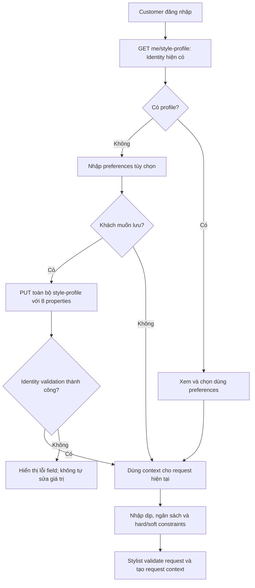
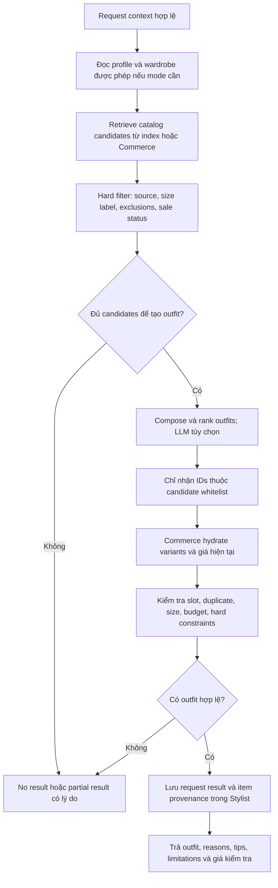
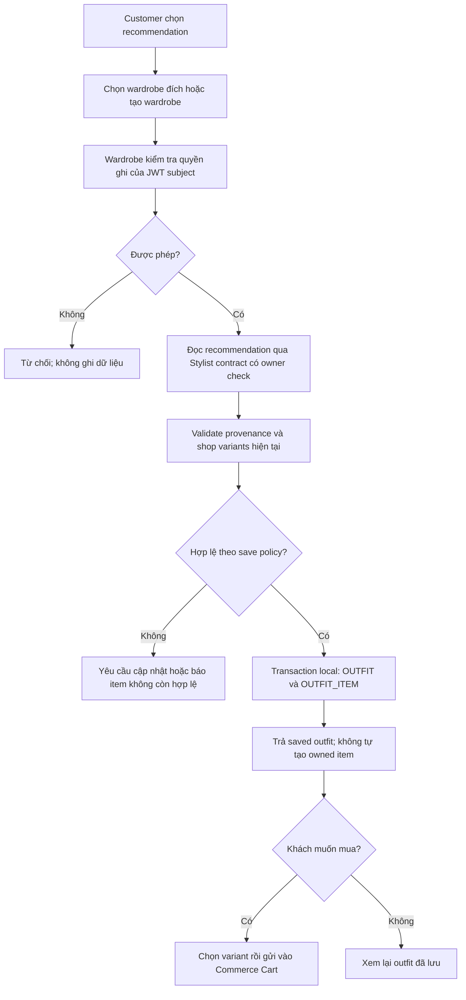
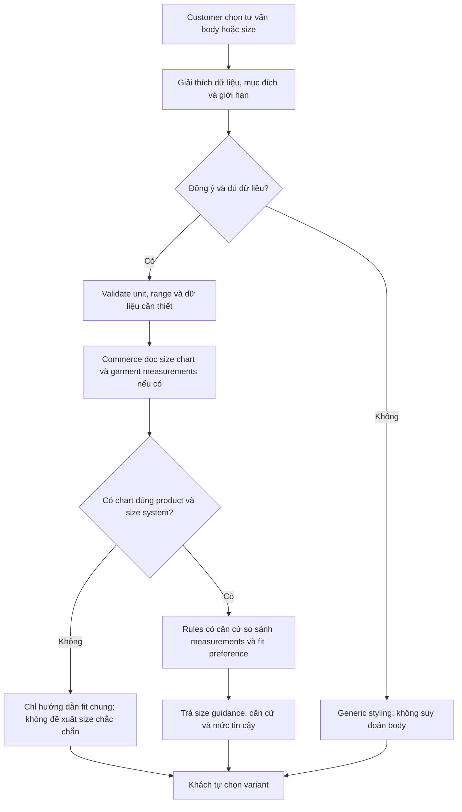
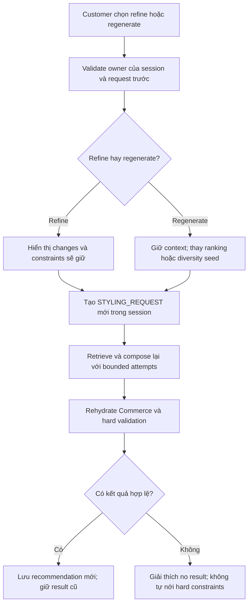
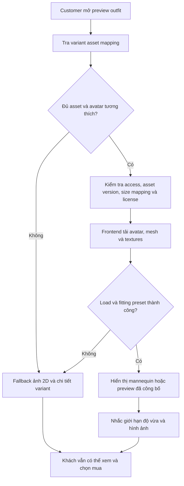
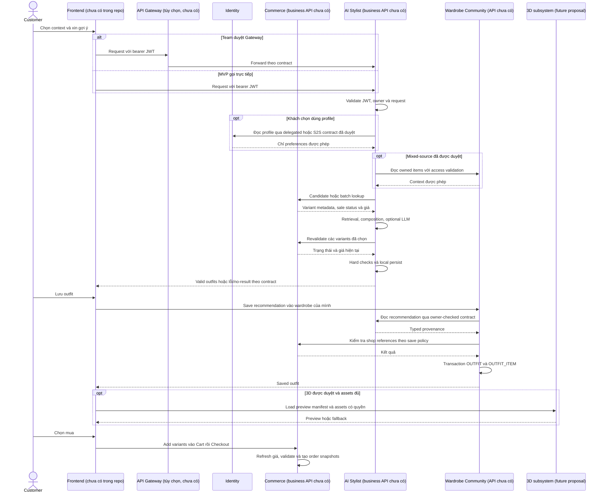

# StyleMind — AI Stylist: Business Analysis & Technical Roadmap

Ngày khảo sát: 10/10/2026. Repository duy nhất: `C:\Users\FPTSHOP\Desktop\StyleMind_BE`.

Branch tại thời điểm khảo sát: `dev`; HEAD: `6f3d30ac4b63a4a4539a98648064416b80b3ed60`.

**Đây là tài liệu phân tích, không phải quyết định phê duyệt, API contract đã chốt hoặc yêu cầu triển khai.** Không sửa code, dependency, logical model, migration, database, Compose, secrets hoặc workbook. Không sử dụng dự án StyleMind cũ làm baseline.

## 1. Executive Summary

### 1.1 Kết luận quan trọng

1. **VERIFIED:** Repo có sáu ứng dụng Java 21 / Spring Boot 3.5.16. Identity có các luồng nghiệp vụ và báo cáo kiểm thử local; Stylist, Commerce và Wardrobe & Community hiện mới có nền tảng service, chưa có API nghiệp vụ hoặc business migration. Một sơ đồ có bảng không đồng nghĩa database đó đã được triển khai.
2. **VERIFIED:** Profile có thể tái sử dụng: sở thích fit, chiều cao, size thường mặc, style/color codes và brand UUID. Dữ liệu này chưa đủ để dự đoán vóc dáng, size vừa chính xác hoặc dựng avatar cá nhân.
3. **VERIFIED:** EP-07 có 10 task thuộc hai User Story, nhưng task “Connect existing Qdrant/Neo4j…” chưa có thành phần “existing” để nối vào: không tìm thấy SDK, container, client, projection hoặc retrieval pipeline trong code/config hiện hành.
4. **OPEN QUESTION:** Mong muốn mới là outfit từ catalog shop; logical model và backlog vẫn cho phép phối món khách sở hữu với món shop. Cần team chốt **catalog-only cho MVP** hay **mixed-source**. Tài liệu không tự xóa nhánh owned-item hoặc coi mong muốn mới là scope đã duyệt.
5. **VERIFIED:** Scope hiện hành loại stock/inventory, reservation, return và refund. Vì vậy không thể cam kết “còn hàng vật lý” hoặc thêm stock service để đáp ứng câu hỏi nghiên cứu. Có thể kiểm tra variant tồn tại, trạng thái được phép bán, size label và giá do Commerce cung cấp sau khi contract được duyệt.
6. **PROPOSAL — NOT APPROVED:** Bắt đầu bằng offline POC: rule-based + retrieval + bộ kiểm tra deterministic, dùng catalog mẫu đã được xác nhận. So sánh với phương án có LLM; chỉ dùng LLM để chọn trong candidate whitelist và diễn đạt lý do, không cho LLM tự tạo sản phẩm/giá.
7. **PROPOSAL — NOT APPROVED:** Lưu outfit vào Wardrobe thông qua `OUTFIT` / `OUTFIT_ITEM`; giữ provenance shop variant. Lưu một outfit chưa mua **không biến nó thành quần áo thực sự sở hữu**.
8. **VERIFIED / đánh giá kỹ thuật:** Không tìm thấy frontend hoặc 3D garment assets trong repo. Ảnh 2D không đủ để bảo đảm tái tạo mặt sau, hình học, chất liệu, pattern và độ vừa của quần áo thật. Nên tách 3D thành workstream/epic được duyệt riêng, không chặn MVP phối đồ.

### 1.2 Nên làm gì trước?

**Khuyến nghị:** Chốt scope catalog-only và ý nghĩa “Build Wardrobe”, rồi làm POC offline trên khoảng 50–100 variant đại diện; không cần tạo database mới hoặc triển khai 3D trong POC. Phải có dữ liệu category, ảnh, size, màu, giá và sale status đủ tin cậy. Nếu catalog thực chưa sẵn sàng, dùng fixture được gắn nhãn rõ là dữ liệu thử nghiệm, tuyệt đối không báo là tích hợp Commerce thật.

POC trả lời ba câu hỏi:

- Có tạo được outfit có cấu trúc hợp lý và không vi phạm hard constraints không?
- Retrieval/LLM có cải thiện chất lượng so với baseline rule-based đủ để bù chi phí và độ trễ không?
- Catalog có đủ metadata để cá nhân hóa, hay phải cải thiện dữ liệu trước khi chọn công nghệ AI?

## 2. Cách đọc và nguồn bằng chứng

### 2.1 Nhãn thông tin

| Nhãn | Ý nghĩa trong tài liệu |
|---|---|
| VERIFIED | Có bằng chứng trực tiếp từ file, source, model, dependency hoặc workbook đã đọc. Không đồng nghĩa production-ready. |
| ASSUMPTION | Giả định phục vụ ước lượng/POC; phải được kiểm tra trước khi biến thành cam kết. |
| PROPOSAL | Phương án phân tích hoặc thiết kế mới, **NOT APPROVED**. |
| OPEN QUESTION | Thiếu quyết định hoặc có xung đột cần Product Owner/Tech Lead xử lý. |

Các mã `BA-*`, `AC-*`, `Q-*` dưới đây chỉ là nhãn nội bộ của **tài liệu phân tích này**, không tạo hay thay thế requirement, OPEN, DR hoặc DEC identifier đã có. Không đổi ID hoặc trạng thái của backlog.

### 2.2 Thứ tự thẩm quyền

Theo [Current Project Context](../governance/CURRENT_PROJECT_CONTEXT.md): quyết định mới nhất của chủ dự án → workbook Backlog → sáu logical model → migration đã áp dụng → contract được duyệt. Source/test/audit là bằng chứng triển khai; chúng không tự phê duyệt nghiệp vụ. Nội dung `docs/archive/` là lịch sử, không dùng để khôi phục scope.

Khi nguồn mâu thuẫn: ghi lại khác biệt, giữ nguyên nguồn, xin quyết định trước triển khai phần bị ảnh hưởng. Không coi timestamp, trạng thái `To Do`, comment model hoặc hành vi test là quyết định của owner.

### 2.3 Danh mục nguồn nội bộ

| Nguồn | Bằng chứng sử dụng |
|---|---|
| [AGENTS.md](../../AGENTS.md) | Sáu service, JDBC/MVC, phạm vi loại trừ, bảo vệ migration và dữ liệu. |
| [Current Project Context](../governance/CURRENT_PROJECT_CONTEXT.md), [Business Rules](../governance/CURRENT_BUSINESS_RULES.md), [Open Decisions](../governance/OPEN_IMPLEMENTATION_DECISIONS.md) | Baseline và các quyết định chưa chốt. |
| `C:\Users\FPTSHOP\Desktop\StyleMind_Task.xlsx`, sheet `Backlog` | EP-05 rows 72–81; EP-07 rows 93–102; dependencies EP-01/02/03/06/08. Số hàng Excel có tính header ở hàng 1. |
| [All Databases](../../database/six-service-model/ALL_DATABASES.md) | Tổng quan logical model và narrative còn có chỗ kế thừa lịch sử. |
| [Identity model](../../database/six-service-model/01_identity.mmd), [Commerce](../../database/six-service-model/02_commerce.mmd), [Payment](../../database/six-service-model/03_payment.mmd) | Ownership và các thuộc tính đích. |
| [Wardrobe & Community](../../database/six-service-model/04_wardrobe_community.mmd), [Stylist](../../database/six-service-model/05_stylist.mmd), [Notification](../../database/six-service-model/06_notification.mmd), [System relationships](../../database/six-service-model/07_system_relationships.mmd) | Provenance, saved outfits, criteria, sharing và tham chiếu logic. |
| [Root README](../../README.md), [Compose](../../docker-compose.yml), sáu `pom.xml` / `application.properties` | Công nghệ, cấu hình và hạ tầng thực sự khai báo. |
| [ManageProfileController](../../identity-service/src/main/java/com/stylemind/identity/controller/ManageProfileController.java), [StyleProfileResponse](../../identity-service/src/main/java/com/stylemind/identity/dto/StyleProfileResponse.java) | API profile có thật và response shape. |
| [ProfileRequestValidator](../../identity-service/src/main/java/com/stylemind/identity/validation/ProfileRequestValidator.java), [ProfileRepository](../../identity-service/src/main/java/com/stylemind/identity/repository/ProfileRepository.java), [ManageProfilePersistenceService](../../identity-service/src/main/java/com/stylemind/identity/service/ManageProfilePersistenceService.java) | Validation, persistence và transaction profile. |
| [Identity JWT decoder](../../identity-service/src/main/java/com/stylemind/identity/security/JwtDecoderConfiguration.java), [Stylist JWT decoder](../../stylist-service/src/main/java/com/stylemind/stylist/security/JwtDecoderConfiguration.java), [Stylist security](../../stylist-service/src/main/java/com/stylemind/stylist/security/SecurityConfiguration.java) | Khoảng cách giữa authentication nền tảng và tích hợp Identity thực tế. |
| [Stylist POM](../../stylist-service/pom.xml), [Stylist OpenAPI](../../stylist-service/src/main/java/com/stylemind/stylist/openapi/OpenApiConfiguration.java) | Chưa có AI dependencies hoặc contract nghiệp vụ. |
| [Identity final acceptance](../qa/identity-final/IDENTITY_FINAL_ACCEPTANCE_REPORT.md) | Bằng chứng kiểm thử local đã báo cáo, không phải lần chạy lại trong khảo sát này. |

### 2.4 Phạm vi kiểm chứng

Đã đọc model, governance, backlog, source/config/dependencies liên quan; tìm kiếm business controllers, AI/vector/graph/broker integrations, frontend và 3D assets trong repo. Không đọc `.env` hoặc raw audit logs; không truy cập database persistent; không chạy build, tests, Compose hay gửi email.

Do đó “không tìm thấy” nghĩa là **không tìm thấy trong repository/config đã khảo sát**, không khẳng định hạ tầng bên ngoài team chắc chắn không tồn tại. Nếu team có Qdrant/Neo4j/FE ở repo khác, cần cung cấp URL, revision, contract và quyền truy cập để bổ sung bằng chứng.

### 2.5 Giả định dùng trong kế hoạch — ASSUMPTION

| Giả định | Dùng để làm gì? | Khi không đúng |
|---|---|---|
| Có thể thu 50–100 variants đại diện, metadata/ảnh có quyền sử dụng | Ước lượng offline POC | Giảm coverage, ghi giới hạn hoặc dành thêm effort cho dữ liệu; không bịa catalog thực. |
| Có người review hiểu phối đồ và đủ thời gian chấm test set | Đo relevance/compatibility, không chỉ validity | Chưa kết luận chất lượng thời trang; deterministic tests vẫn đo riêng. |
| Commerce/Wardrobe contracts sẽ được các owner cung cấp trước live MVP | Effort Phase 2 chỉ tính Stylist và phối hợp tích hợp | Re-estimate dependencies; không chuyển việc owner khác sang Stylist âm thầm. |
| Mỗi shop item trong outfit mẫu có quantity 1, tiền VND nguyên | JSON example và budget minh họa | Quy tắc quantity/currency khác cần contract rõ trước implementation. |
| 3D POC có artist, fixed avatar và dữ liệu sản phẩm đủ | Range 20–50 person-days | Không áp dụng range cho personalized avatar/cloth physics hoặc team chỉ có BE. |

Các giả định này không phải requirements hoặc cam kết của team. Số lượng dataset, effort và threshold chỉ được baseline hóa sau review.

## 3. AS-IS: hệ thống hiện tại

### 3.1 Sáu service và mức triển khai

| Service / database | Trách nhiệm hiện hành | Đã có trong source | Chưa có / mới là thiết kế |
|---|---|---|---|
| Identity / `stylemind_identity` | Account, authentication, profile, address, admin users | Register/verify/resend, Login/JWT/JWKS, refresh/logout, Forgot/Reset, Manage Profile/Address/Users; Flyway V1–V3 | Không có body measurements đầy đủ, size chart hoặc consent domain cho AI/3D. |
| Commerce / `stylemind_commerce` | Catalog, Cart, Checkout, Order | Bootstrap, JDBC datasource, security/errors/logging/OpenAPI nền tảng | 13 logical entities; chưa có business migration/controller/repository hoặc catalog/cart API. |
| Payment / `stylemind_payment` | Payment và payment exceptions | Bootstrap và datasource | Ba logical entities; nghiệp vụ thanh toán chưa implement. Không đưa refund trở lại scope. |
| Wardrobe & Community / `stylemind_wardrobe_community` | Tủ đồ, outfits, sharing, friends, friend chat | Bootstrap và datasource | 10 logical entities; chưa có Wardrobe API, image upload hoặc authorization sharing. |
| Stylist / `stylemind_stylist` | AI consultation, requests, recommendations, knowledge | Bootstrap và datasource | Chín logical entities; chưa có business API, migrations, AI provider, retrieval hoặc evaluation harness. |
| Notification / `stylemind_notification` | Delivery thông báo/email | Hai internal email controllers cho xác minh và password reset; SMTP integration cho Identity | Hai logical entities cho notification/delivery attempts chưa có business migration. Không suy ra AI notification/inbox đã có. |

**VERIFIED:** Bộ model có 48 entities: Identity 11, Commerce 13, Payment 3, Wardrobe & Community 10, Stylist 9, Notification 2. Identity có 11 bảng nghiệp vụ được mô tả bởi V1–V3; metadata Flyway không phải business entity. Với 37 entities còn lại, đây là **target logical model**, không phải kết quả truy vấn database đang chạy.

### 3.2 Công nghệ và hạ tầng thực sự có

- Java 21, Spring Boot 3.5.16, Spring MVC, Spring JDBC/PostgreSQL, Actuator, Spring Security OAuth2 Resource Server, SpringDoc 2.8.17.
- Compose khai báo một PostgreSQL 18 container, sáu ứng dụng và Mailpit. Database-per-service là sáu logical database với tài khoản tách biệt trên PostgreSQL local, không phải sáu PostgreSQL container.
- Identity có Flyway và validation; không suy ra Stylist đã có migration framework vì Identity có nó.
- Không tìm thấy Qdrant, Neo4j, Kafka/RabbitMQ, AI provider adapter, embedding pipeline hoặc Spring AI dependency trong production source/POM/Compose hiện hành.
- Không tìm thấy frontend application source hoặc garment/avatar assets `.glb`, `.gltf`, `.fbx`, `.obj`, `.blend`. Các SVG model trong `database/` là sơ đồ, không phải 3D assets.
- Không có API Gateway application/container. Sequence phía sau dùng Gateway **tùy chọn, PROPOSAL**, không tạo service thứ bảy.

### 3.3 Dữ liệu có thể tái sử dụng từ Identity

`ManageProfileController.getStyleProfile()` → `GET /api/v1/me/style-profile` trả:

```json
{
  "style_profile": {
    "fit_preference": "REGULAR",
    "height_cm": 165.0,
    "usual_top_size": "M",
    "usual_bottom_size": "M",
    "shoe_size": "38",
    "style_codes": ["MINIMAL"],
    "color_codes": ["BLACK", "WHITE"],
    "brand_ids": []
  }
}
```

Các giá trị trên là **ví dụ**, không phải enum/taxonomy đã được phê duyệt. Khi chưa có profile, API có thể trả `style_profile: null`; không tự tạo row khi GET.

**VERIFIED, theo validator và source:**

- `height_cm`: 50–250 cm, tối đa một chữ số thập phân.
- Size là chuỗi tối đa 32 code points, không phải hệ size EU/US hoặc bảng size từng brand đã chuẩn hóa.
- Preference code được kiểm tra cú pháp/canonical hóa; không có bằng chứng mỗi code đều thuộc một danh mục fashion đã duyệt.
- Collections có giới hạn 50 phần tử và loại trùng theo contract; brand UUID được kiểm tra cú pháp/tính duy nhất, không xác minh tồn tại hoặc active trong Commerce.
- `PUT /api/v1/me/style-profile` thay toàn bộ aggregate với tám properties, không phải PATCH từng preference. Không gọi PUT này chỉ để “ghi lại” preferences mà Stylist tự suy đoán.
- `/me` dựa trên JWT subject. Stylist không được đọc DB Identity hoặc dùng Admin Manage Users API để lấy profile cho khách.

**Hệ quả BA:** `height_cm = 165` và `usual_top_size = M` không chứng minh người này có vóc dáng nào, cũng không chứng minh variant M của mọi brand đều vừa.

### 3.4 Data ownership

| Dữ liệu | Nguồn chính | Stylist được làm gì? |
|---|---|---|
| Account, JWT, profile/preferences | Identity | Đọc qua contract có xác thực; không copy password/email challenges hoặc truy cập DB. |
| Product, category, brand, variant, size label, sale status, ảnh, giá hiện tại | Commerce, hiện là target | Dùng projection/cache để tìm candidate; gọi Commerce kiểm tra lại trước persist/checkout. |
| Stock vật lý / reserved quantity | **Không thuộc scope hiện tại** | Không suy đoán từ sale status; không tạo stock column/service. |
| Owned wardrobe items, saved outfits, criteria, visibility/sharing | Wardrobe & Community, hiện là target | Đọc dữ liệu được phép; lưu outfit qua owner service. |
| AI session, request, constraints, recommendation, reasons | Stylist, hiện là target | Sở hữu nghiệp vụ tương ứng sau khi migration/API được duyệt. |
| Vector / graph catalog projection | Chưa có; PROPOSAL dưới Stylist | Chỉ index phục vụ truy xuất; không làm nguồn giá/quyền/tình trạng bán. |
| Cart, checkout, order snapshots | Commerce, hiện là target | Gửi lựa chọn variant; không tạo order trực tiếp hoặc thay giá authoritative. |
| 3D mesh, rig, textures, size mapping | Chưa có owner/asset pipeline được duyệt | Đề xuất quản lý asset mapping theo Commerce/product và orchestration; chưa chọn DB/service mới. |

### 3.5 Authentication vẫn là dependency

Identity đã có decoder kiểm tra issuer/audience và claims theo contract. `stylist-service` hiện có decoder bootstrap cấu hình từ JWK URI/algorithm, mặc định fail-closed khi chưa cấu hình; `/api/**` mới yêu cầu authenticated. Không có bằng chứng đã triển khai cùng mức issuer/audience/role/owner validation như Identity.

**PROPOSAL:** Trước HTTP MVP, chốt và kiểm thử resource-server contract tương thích Identity: signature, algorithm allowlist, issuer, audience, expiry, UUID subject, role mapping và A/B ownership. Không mở route chỉ vì JWT decode được. Với profile downstream, chọn delegated bearer `/me` hoặc contract service-to-service có phạm vi cụ thể; không forge token, truyền tùy ý `customer_id` hoặc tái sử dụng secret SMTP làm business credential.

Các thay đổi về bảo đảm live account status, token revocation hoặc quyền sau suspend phải được chốt; không tự hứa rằng mọi service ngay lập tức chặn access JWT cũ chỉ vì Identity đã có một số live-authorization guards.

## 4. Bất nhất và gap phải xử lý

| Điểm | Nguồn đối chiếu | Kết luận / hành động |
|---|---|---|
| “existing Qdrant/Neo4j” | Backlog R98 vs POM/source/Compose | Chưa có trong repo. Hỏi hạ tầng bên ngoài; nếu không có, đề xuất bổ sung bootstrap/ingestion tasks trước R98, không báo task chỉ là nối client. |
| Catalog-only vs owned + shop | Yêu cầu sản phẩm mới vs R95/R97, `REQUEST_WARDROBE_ITEM`, `RECOMMENDATION_ITEM.source_type` | Chốt MVP mode. Không xóa model/provenance hoặc bỏ test owned mà không cập nhật acceptance được duyệt. |
| “Hết hàng” | Yêu cầu nghiên cứu QA vs governance loại inventory | Hiện chỉ test inactive/missing variant và size label không có. Test stock thực phải DEFERRED/OUT OF SCOPE, không PASS giả. |
| Body-aware / 3D | Hướng sản phẩm mới vs profile/model/backlog/asset inventory | Chưa đủ data/contract/tasks; là research và PROPOSAL, không implement âm thầm. |
| Profile đã implement nhưng narrative còn TBD | `ALL_DATABASES.md` một số OPEN/narrative cũ vs source và US-02.05 evidence | Không block lại profile đã được duyệt; mapping taxonomy cho AI vẫn là quyết định riêng. Không sửa narrative trong lượt này. |
| README đầu trang chưa phản ánh hết Identity | Root README vs controllers/audit US-02.05–07 | Ghi nhận độ phủ tài liệu; không dùng opening summary để phủ nhận các API có thật. |
| Model có knowledge review, backlog không có story Admin knowledge rõ ràng | `KNOWLEDGE_SOURCE/ENTRY` vs EP-07 | Knowledge ingestion/review là dependency cần scope/owner. POC có thể dùng rule set curated offline; không tự tạo Admin knowledge portal. |
| Audit local vs trạng thái runtime hiện tại | Final acceptance report vs lượt khảo sát read-only | Dẫn bằng chứng lịch sử, không tuyên bố vừa rerun 138/23 tests hoặc stack hiện xanh. |
| Migration hash lịch sử | Hash byte hiện tại vs report lưu dạng LF | Chuẩn hóa line ending trong bộ nhớ cho hash khớp lịch sử; không sửa migration. Đây không phải xác nhận Flyway checksum runtime hoặc drift database. |

## 5. TO-BE và Business Analysis

### 5.1 Mục tiêu và giá trị

**Mục tiêu sản phẩm được đưa ra để nghiên cứu:** Khách biết nên phối những gì trong shop theo dịp, sở thích và ngân sách; lưu lựa chọn để xem lại/mua; tiến tới tư vấn body/size và thử đồ nếu dữ liệu đủ.

AI Stylist không chỉ là chatbot trả lời “mặc áo gì?”. Kết quả phải là tập variant cụ thể, có vai trò trong outfit, lý do phối, nguồn dữ liệu và trạng thái kiểm tra. Chất lượng không được đo chỉ bằng câu trả lời trôi chảy.

### 5.2 Personas phục vụ thiết kế — PROPOSAL

| Persona | Vấn đề | Giá trị mong muốn | Không nên suy đoán |
|---|---|---|---|
| Khách chưa biết phối | Nhiều sản phẩm, khó chọn bộ hoàn chỉnh | 2–3 phương án dễ hiểu trong ngân sách | Không mặc định giới tính, vóc dáng hoặc sở thích từ tên/email. |
| Khách có style rõ | Muốn màu/fit/brand phù hợp | Ưu tiên preference nhưng không bỏ qua hard constraints | Sở thích brand không chứng minh brand ID hợp lệ. |
| Khách nhạy cảm ngân sách | Sợ tổng tiền vượt khả năng | Tổng tiền minh bạch cho các món phải mua | Không giấu món đắt bằng cách chỉ báo giá một item. |
| Khách lưu tủ đồ ảo | Muốn so sánh và dùng lại outfit | Saved outfits có provenance, không tự đánh dấu owned | Lưu chưa phải mua; mua chưa chắc đồng nghĩa cập nhật tủ đồ tự động. |
| Người phụ trách nội dung | Muốn gợi ý phù hợp catalog và lời giải thích có căn cứ | Rule review, evaluation và dữ liệu catalog sạch | Không tạo quyền Admin knowledge mới chỉ từ persona phân tích. |

### 5.3 “Build Wardrobe” có bốn nghĩa khác nhau

| Nghĩa | Dữ liệu / hành vi | Mức hỗ trợ hiện tại |
|---|---|---|
| Wishlist sản phẩm | Danh sách món muốn mua riêng lẻ | Chưa có entity/story wishlist rõ ràng; không thêm bảng chỉ vì gọi là wardrobe. |
| Saved outfits | Lưu một bộ phối gồm shop variants hoặc owned items | Có target `OUTFIT`, `OUTFIT_ITEM`, US-05.03. Khuyến nghị dùng nghĩa này cho MVP. |
| Planned wardrobe | Kế hoạch mua theo mùa/ngân sách, lịch sử nhu cầu | Chưa có purchase-plan domain; cần scope mới. |
| Actual owned wardrobe | Quần áo khách đã có, có metadata/ảnh cá nhân | Có target `WARDROBE_ITEM`, US-05.01; hiện chưa implement. |

**PROPOSAL:** MVP “Build Wardrobe” = tạo tủ đồ và lưu outfits muốn mặc/mua. `OUTFIT_ITEM.source_type = SHOP_VARIANT` không tạo `WARDROBE_ITEM`. Nếu sau này muốn “thêm món đã mua vào tủ”, cần rule riêng: thời điểm, xác nhận của khách, nhiều số lượng, duplicate và event mua hàng. Không suy ra tính năng đó từ `origin_shop_variant_id`.

### 5.4 Các hành trình

1. **Khám phá → lựa chọn → lưu:** Login → xem/nhập preferences → chọn dịp và ngân sách → nhận nhiều outfit → đọc lý do/giá → refine → lưu outfit vào tủ của mình.
2. **Lựa chọn → mua:** Mở outfit → refresh thông tin shop → chọn size/variant thực sự cần mua → thêm vào Cart → Checkout do Commerce làm → Commerce đóng băng giá/địa chỉ. Không tự mua toàn bộ outfit chỉ bằng nút “Gợi ý”.
3. **Owned + shop, nếu được duyệt:** Chọn món đã sở hữu trong wardrobe được phép → AI chỉ bổ sung shop items thích hợp → owned item không có giá mua và không gửi vào cart.
4. **Body-aware, nếu được duyệt:** Tự nguyện cung cấp dữ liệu cần thiết → nhận guidance có confidence/limitations → vẫn chọn size; không hứa vừa tuyệt đối.
5. **3D, nếu được duyệt:** Chọn outfit có assets tương thích → xem mannequin/preview → thiếu asset quay về ảnh 2D và chi tiết sản phẩm; mua hàng không bị chặn.

### 5.5 User Stories đề xuất và liên hệ backlog

| Nhãn phân tích | Story | Backlog / trạng thái |
|---|---|---|
| BA-01 | Là khách hàng, tôi muốn đưa dịp, sở thích và ngân sách để có outfit phù hợp nhu cầu. | US-07.01/02; contract chưa duyệt. |
| BA-02 | Là khách hàng, tôi muốn xem nhiều phương án khác nhau và lý do để chọn bộ mình thích. | US-07.02; số phương án/diversity cần chốt. |
| BA-03 | Là khách hàng, tôi muốn lưu outfit vào tủ của mình để xem lại trước khi mua. | US-05.03; chỉ là target. |
| BA-04 | Là khách hàng, tôi muốn refine yêu cầu để thay món không thích mà vẫn giữ giới hạn ngân sách. | Có conversation/request model; refine semantics chưa chốt. |
| BA-05 | Là khách hàng, tôi muốn chọn variant từ outfit và đi qua cart/checkout để mua đúng món. | Phụ thuộc US-03.06/08; không chuyển ownership order sang Stylist. |
| BA-06 | Là khách hàng, tôi muốn được hướng dẫn fit/size từ dữ liệu tự nguyện để chọn tự tin hơn. | PROPOSAL bổ sung, không phải task EP-07 đã có. |
| BA-07 | Là khách hàng, tôi muốn xem preview 3D khi asset có sẵn để hình dung bộ phối. | PROPOSAL workstream riêng. |

### 5.6 Rules và Acceptance Criteria đề xuất

Các rule mới trong bảng này là **PROPOSAL — NOT APPROVED**. Những rule đã có căn cứ được ghi nguồn rõ.

| Rule | Nội dung | AC / nguồn |
|---|---|---|
| BA-R01 | Subject JWT quyết định owner; client không được lựa chọn `customer_id` thay người khác. | AC-01: A không đọc/sửa trái phép dữ liệu của B; wardrobe sharing chỉ cho phép theo rule đã duyệt của owner service, không mặc nhiên cho write; governance + R94/R96. |
| BA-R02 | Chỉ shop variants có thật và được phép bán mới được đưa vào kết quả shop. | AC-02: mọi ID hydrate thành công từ Commerce; R101/102. Vocabulary sale status phải chốt. |
| BA-R03 | Owned item và shop variant là hai provenance loại trừ nhau. | AC-03: đúng một source reference; không đưa owned item vào cart; logical models + R97/R80. |
| BA-R04 | Giá hiển thị được lấy từ Commerce, không từ LLM/vector/graph. | AC-04: recompute tổng giá trước lưu; R101/102. Giá có thể thay đổi sau thời điểm kiểm tra. |
| BA-R05 | Hard budget giới hạn tổng chi phí shop items trong **mỗi outfit**, với quantity được định nghĩa. | AC-05: không có outfit vượt hard budget; không âm, không số lẻ VND; R101/102. Per-outfit/quantity cần owner chốt. |
| BA-R06 | Hard exclusions không được tự nới lỏng khi thiếu kết quả. | AC-06: trả thiếu/no result và giải thích, không lén dùng màu/category bị cấm. |
| BA-R07 | Soft preferences tăng ranking, không trở thành điều kiện “bắt buộc” ngầm. | AC-07: phản hồi giải thích preference nào chưa đáp ứng; khác biệt hard/soft hiển thị rõ. |
| BA-R08 | Không đủ candidate → trả ít hơn số yêu cầu hoặc no eligible result theo contract. | AC-08: không bịa món để đủ ba outfit; không hoàn chỉnh giả bộ thiếu slot bắt buộc. |
| BA-R09 | Save outfit cần quyền ghi vào wardrobe đích và provenance hợp lệ. | AC-09: API Wardrobe kiểm tra lại; R80/81. Đọc shared wardrobe không mặc nhiên được ghi. |
| BA-R10 | Refine tạo request mới, không sửa âm thầm kết quả cũ đã lưu. | AC-10: lịch sử thể hiện request và result riêng; không thêm parent column khi schema chưa duyệt. |
| BA-R11 | LLM không được suy đoán body shape, giới tính, sức khỏe từ email/tên/ảnh không có consent. | AC-11: thiếu dữ liệu → generic styling; body-specific là opt-in proposal. |
| BA-R12 | 3D chỉ là preview theo loại đã công bố; không chứng nhận vừa thật. | AC-12: asset thiếu/incompatible → fallback; không báo “perfect fit”. |
| BA-R13 | Revalidate sau AI generation và trước save; tại checkout Commerce kiểm tra lại lần nữa. | AC-13: price/sale changes trong lúc AI chạy bị xử lý; không hứa atomic snapshot xuyên service. |
| BA-R14 | Friend `CHAT_SESSION` và AI `STYLIST_SESSION` là hai domain riêng. | AC-14: không lấy private chat làm prompt context; model comment và EP-06/07. |
| BA-R15 | Budget null thì không có hard maximum; budget hard mà không có amount là input không nhất quán. | AC-15: reject/normalize đúng contract duyệt; các model đã có chú thích `budget_is_hard`. |

### 5.7 MVP và phần hoãn

**PROPOSAL MVP:** catalog-only, context nhập tay + profile tự nguyện, structured outfits, reasons/tips, deterministic validation, owner isolation, refine tạo request mới, saved outfits, handoff variant sang Cart khi Commerce sẵn sàng.

**Không tự đưa vào MVP:** stock/reservation; automatic weather/geolocation; body shape inference từ ảnh; size guarantee; 3D; wishlist/planned wardrobe mới; automatic purchased-item import; friend chat AI; Admin knowledge management UI; service mới; notification “AI done” ngoài backlog đã duyệt.

Mixed-source là nhánh existing target phải được **quyết định** giữ cho MVP hoặc deferred, không gọi là scope bị loại bỏ sẵn. Sharing/friend chat vẫn thuộc EP-06; catalog MVP không được tự xóa nó khỏi dự án.

## 6. Business & System Flows

Toàn bộ sáu flow và sequence dưới đây là **TO-BE / PROPOSAL — NOT APPROVED**. Các bước Identity có thật được đánh dấu trong mô tả; các API downstream chưa có.

### 6.1 Flow 1 — Onboarding và preferences



- **Input:** JWT, profile optional, occasion/intended use/style, budget và constraints.
- **Output:** Request context hợp lệ; profile chỉ được cập nhật khi khách chọn lưu.
- **Validation:** Identity validator cho profile; Stylist validator cho context, budget, number of results, taxonomy và hard/soft consistency sau khi contract được duyệt.
- **Rule:** Preferences không phải measurement; null profile không phải lỗi hệ thống. Không âm thầm tạo profile từ prompt.
- **Dependencies:** Identity hiện có; Stylist create request chưa có. Taxonomy mapping cần Commerce/curated rules.
- **Errors:** 401/403 theo auth; profile service unavailable → cho nhập context tay nếu policy được duyệt và đánh dấu nguồn thiếu; không gọi fallback rồi giả là đã đọc profile thành công.

### 6.2 Flow 2 — AI Outfit Recommendation



- **Input:** Request ID/context đã validate, profile optional, candidates có nguồn.
- **Output:** 0..N outfits hợp lệ và trạng thái kết quả theo vocabulary cần duyệt.
- **Validation:** Whitelist IDs, không duplicate vô nghĩa, số item/slot theo rule, price sum, hard budget, sale status và size label. In-stock vật lý không được giả định.
- **Rule:** Bước hydrate cuối là bắt buộc; no result tốt hơn fake result. Giá thuộc Commerce; LLM chỉ sinh explanation/selection trong giới hạn.
- **Dependencies:** Catalog detail/batch lookup, rule set, provider adapter nếu dùng LLM, Stylist migrations.
- **Errors:** Provider timeout → bounded fallback rule-based nếu đã duyệt; Commerce unavailable → không lưu kết quả shop dưới danh nghĩa đã validated; response structured lỗi → reject/retry có giới hạn, không parse text tùy tiện thành IDs.

### 6.3 Flow 3 — Save / Build Virtual Wardrobe



- **Input:** Recommendation ID, target wardrobe, tên outfit; không tin `owner_user_id` từ body.
- **Output:** Outfit ID thuộc Wardrobe, source recommendation logical reference và typed item provenance.
- **Validation:** Quyền ghi, recommendation owner/access, item source XOR, nonempty outfit, variant existence và save policy.
- **Rule:** Saved outfit không phải payment/order/owned wardrobe. Request lặp có thể tạo duplicate nếu chưa duyệt idempotency policy; không cam kết exactly-once chỉ bằng UI disable button.
- **Dependencies:** US-05.01/03, Stylist retrieval contract, Commerce batch lookup; Cart phụ thuộc US-03.06.
- **Errors:** Downstream failure → không ghi nửa outfit; local rollback. Không distributed transaction; nếu cần reliable save retry/dedup phải duyệt contract và persistence scope.
- **OPEN QUESTION:** Outfit đã lưu có được giữ reference sản phẩm sau khi discontinued để xem lịch sử không? Tách “được lưu lịch sử” khỏi “được mua”; không tự thêm historical price snapshot vào model.

### 6.4 Flow 4 — Body-aware Styling / Size Guidance



- **Input:** Dữ liệu tự nguyện và size system; measurements cần có tùy garment, không bắt khách nhập mọi số đo nếu không cần.
- **Output:** Guidance có limitations, không “size guarantee” hay đánh giá cơ thể.
- **Validation:** Cm/inch phải rõ; measurement range và cách đo phải được chuyên gia/owner duyệt, không tái dùng height validator để kiểm tra mọi số đo.
- **Rule:** Stylist không dùng tên/gender mặc định làm kích thước; không xác định body shape từ chiều cao. Cơ sở size label M/S giữa brand khác nhau không đồng nhất.
- **Dependencies:** Quyết định consent/storage/retention; garment dimensions hoặc size chart của Commerce; taxonomy và rule review. Các dữ liệu này hiện chưa có trong model đủ để implement.
- **Errors:** Missing/mismatched chart → generic guidance; measurements mâu thuẫn → yêu cầu sửa; không trả size sai chỉ để có response.

### 6.5 Flow 5 — Refine / Regenerate



- **Input:** Session ID, previous request/recommendation, refinement text hoặc structured changes.
- **Output:** Request/result mới; history cũ giữ nguyên.
- **Validation:** Source request thuộc session; IDs locked/excluded phải hợp lệ; confirmation nếu khách đổi hard budget/exclusion.
- **Rule:** Text “cho bộ khác” không tự tăng budget. Diversity không đáng để vi phạm constraint. Catalog-only không đổi thành owned mode chỉ vì prompt nhắc quần áo cá nhân.
- **Dependencies:** Request/history API, retrieval/generation, budget limits và rate control policy.
- **Errors:** Không tìm thấy item được yêu cầu giữ → hỏi/chỉ rõ, không chọn món tương tự rồi giả là giữ nguyên; provider fail không làm mất previous result.
- **Model gap:** `parent_request_id`, locked item fields hoặc persisted diversity seed chưa có. Có thể gửi previous context ở runtime cho POC; cần phê duyệt trước khi thêm persistence cho liên kết refine.

### 6.6 Flow 6 — 3D Virtual Try-On / Fallback



- **Input:** Outfit variants, loại avatar/preview được phép, asset manifest.
- **Output:** 3D preview hoặc fallback rõ ràng, không chặn catalog/cart.
- **Validation:** Format, file size, origins/storage permissions, color/size mapping, rig compatibility và license. Không dùng arbitrary asset URL từ LLM.
- **Rule:** Thiếu mesh không “generate chính xác” chỉ từ ảnh catalog; lỗi renderer không phải lỗi recommendation.
- **Dependencies:** 3D artists/assets, frontend renderer, delivery/CDN, manifest contract; tất cả chưa có trong repo.
- **Errors:** Asset 404, CORS, corrupt GLB, unsupported texture, clipping/performance → fallback; telemetry không chứa ảnh body/private measurements.

### 6.7 Sequence tổng thể



Gateway và 3D participants là cách thể hiện luồng, **không phê duyệt service mới**. Không có transaction chung bao Identity/Commerce/Stylist/Wardrobe. Access, price và sale checks chỉ bảo đảm tại điểm kiểm tra; thay đổi sau đó phải được xử lý khi đọc/lưu/mua lại.

## 7. Kiến trúc recommendation đề xuất

### 7.1 Các thành phần làm việc gì?

| Cách tiếp cận | Vai trò / điểm mạnh | Hạn chế | Khuyến nghị |
|---|---|---|---|
| Rule-based | Xác định slots, exclusions, budget, fit/context rules; rẻ, dễ giải thích và test | Cần rule/metadata tốt; dễ đơn điệu | Là baseline và hard validation bắt buộc. |
| Semantic retrieval | Tìm sản phẩm gần ý nghĩa “đi làm tối giản” từ text/ảnh | Similarity không chứng minh các món phối hợp đẹp hoặc vừa | Dùng để chọn candidates, không thay compatibility rules. |
| Qdrant | Vector retrieval, filtering, hybrid search | Cần embeddings, ingestion, freshness; không hiểu nghiệp vụ giá/quyền tự động | Optional retrieval adapter, benchmark trước. |
| Neo4j | Biểu diễn quan hệ category/style/occasion/compatibility/rule provenance | Đắt công xây graph nếu chưa có knowledge hữu ích | Chỉ đưa vào MVP nếu graph benchmark có lợi; không bắt buộc chỉ vì backlog ghi tên. |
| LLM | Hiểu context text, chọn/rank trong candidates, diễn đạt explanations/tips | Hallucination, latency, cost, prompt injection, nondeterminism | Bounded role; không làm source of truth hoặc hard validator. |
| Hybrid | Retrieval → deterministic compose/constraints → optional LLM → revalidation | Nhiều bước và contracts phải quản lý | Khuyến nghị, nhưng tăng thành phần từng bước sau POC. |

Qdrant có Java client và REST/gRPC interfaces; filtering và hybrid queries là khả năng retrieval, không phải bộ kiểm chứng catalog. [Qdrant interfaces](https://qdrant.tech/documentation/interfaces/), [Filtering](https://qdrant.tech/course/beginners/module-3/filtering/), [Hybrid queries](https://qdrant.tech/documentation/search/hybrid-queries/).

Neo4j có Java Driver; nếu chọn dùng, đặt sau adapter riêng, không chuyển relational JDBC model sang graph persistence. [Neo4j Java Driver](https://neo4j.com/docs/java-manual/current/install/).

### 7.2 Pipeline cụ thể

1. **Context resolver:** Lấy input tường minh, profile được khách chọn dùng và owned context nếu mode được duyệt. Phân biệt absent/empty/unavailable; resolve precedence theo contract.
2. **Taxonomy mapper:** Chuyển codes/description về category/style/color/occasion có version. Không coi mọi string Identity chấp nhận đều có nghĩa trong catalog.
3. **Candidate retrieval:** Chọn tập hữu hạn, filter hard điều kiện biết được. Offline POC có thể dùng file fixture; live phải hydrate từ Commerce.
4. **Outfit composer:** Chọn slots theo outfit template được duyệt; tìm tổ hợp không trùng, phù hợp occasion, tương thích màu/chất liệu và budget. Có thể dùng bounded search/beam ranking; không để LLM sinh vô hạn tổ hợp.
5. **Ranking/diversity:** Chấm soft preference và độ khác biệt giữa các outfit. Không đánh giá chỉ bằng embedding distance.
6. **Optional LLM adapter:** Nhận minimal context + candidate whitelist + rules; yêu cầu structured output chứa IDs/reasons. Không gửi email, password, toàn bộ profile hoặc private chat.
7. **Grounding validator:** Reject IDs ngoài candidates, missing refs, wrong source; hydrate Commerce hiện tại rồi tính lại giá/constraints.
8. **Persistence:** Chỉ persist result đã qua validation; lỗi downstream không để lại recommendation items nửa vời. Request lifecycle cần được duyệt trước migration.
9. **Response assembler:** Lấy product name/image/price từ authoritative data, không dùng LLM làm tên/giá. Ghi limitations và validation time trong API nếu contract chấp thuận; không tự thêm cột DB để chứa chúng.

**Body-aware không phải bước bắt buộc của pipeline MVP.** Outfit template (ví dụ top + bottom, hoặc dress) và size substitution cần chuyên môn/nghiệp vụ; không giả định mọi outfit bắt buộc có shoes/accessory.

### 7.3 Java layers — PROPOSAL

Giữ Spring MVC → Service → Repository với Spring JDBC:

| Lớp / adapter dự kiến | Trách nhiệm |
|---|---|
| `StylistSessionController`, `StylingRequestController`, DTO/validator | HTTP binding, validation, auth context, OpenAPI; không gọi LLM trực tiếp. |
| `StylistSessionService`, `RecommendationOrchestrator` | Ownership, orchestration, policy; tách remote calls khỏi local write transaction dài. |
| `ConstraintEvaluator`, `OutfitComposer`, `RecommendationGroundingValidator` | Logic deterministic độc lập provider, testable bằng fixtures. |
| `IdentityProfileClient`, `CommerceCatalogClient`, `WardrobeContextClient` | Timeout/error contract, minimal data, không truy cập DB ngoài service. |
| `CandidateRetrievalPort` / rule, Qdrant adapters | Có baseline thay được; không buộc domain phụ thuộc vector SDK. |
| `KnowledgeRetrievalPort` / curated, Neo4j adapter | Chỉ rule được duyệt; chưa có knowledge Admin feature. |
| `AiGenerationPort` / provider adapter | Budgeted call, structured output, timeout, không log prompts/raw responses chứa PII. |
| `StylistRepository`, local persistence service | JDBC mappings, transaction request/result/items; không persistence vào DB Wardrobe. |

Tên lớp là kế hoạch, **không phải source đang tồn tại**. Không thêm JPA, Redis, message broker hay AI library trong tài liệu này.

**Backlog gate:** Baseline rule-only là phương án so sánh/POC, không tự hoàn thành R100 vì task hiện yêu cầu selected AI provider. Tương tự, bỏ Neo4j/Qdrant khỏi release không tự hoàn thành R98. Nếu benchmark dẫn tới pipeline đơn giản hơn, owner phải duyệt thay đổi acceptance tương ứng; không sửa task hoặc báo EP-07 DONE từ lựa chọn kỹ thuật chưa duyệt.

Nếu team chọn Spring AI, phải chọn nhánh tương thích Boot 3.5: compatibility table chính thức hiện nêu Spring AI 1.1.x với Boot 3.5.x, trong khi 2.x hướng Boot 4. Không copy sample 2.x vào repo 3.5 chỉ vì tài liệu mới nhất. [Spring AI compatibility](https://github.com/spring-projects/spring-ai/blob/main/README.md). Structured output converters giúp parse/validate shape nhưng không bảo đảm nội dung đúng sự thật; Commerce validation vẫn bắt buộc. [Structured output](https://docs.spring.io/spring-ai/reference/api/structured-output/converters.html).

### 7.4 Kiểm soát hallucination

- Whitelist variant IDs được backend cung cấp; không để model gọi arbitrary endpoint hoặc tự tra DB.
- Parse schema nghiêm; reject unexpected fields/types/IDs. Structured output không thay business validation.
- Names, images, price, sale status: backend hydrate; lý do không được khẳng định “chống nước”, “giảm béo”, “vừa hoàn hảo” khi catalog/rules không có bằng chứng.
- Tính tiền bằng số nguyên VND/checked arithmetic, không float. Với mixed-source, chỉ tính khoản shop cần mua; quantity semantics cần duyệt.
- Hard constraints kiểm tra bằng code/rules đã duyệt; không nhờ LLM tự xác nhận “tôi tuân thủ budget”.
- Revalidation thất bại → remove/recompose có giới hạn hoặc no-result. Không silently dùng stale price khi Commerce outage.
- Knowledge draft không dùng production; product description và nguồn URL là untrusted content. Text “ignore previous instruction” trong catalog không được thay auth/policy.
- Tối đa candidate count, output items, attempts và provider cost; giá trị cụ thể là quyết định triển khai, không giả SLA.
- Giữ provenance rõ để người review biết item từ shop hay owned, source nào bị thiếu và rule nào được áp dụng.

### 7.5 Embeddings và FashionCLIP

**PROPOSAL:** Benchmark multilingual text embeddings trước; thử image/text embedding chuyên fashion nếu ảnh tốt và use cases cần tìm bằng hình. FashionCLIP là một hướng nghiên cứu có repository của tác giả, không phải bằng chứng đã hỗ trợ tiếng Việt, catalog StyleMind hoặc outfit compatibility chính xác. Phải kiểm tra license/model weights/dataset và chất lượng bằng test set riêng. [FashionCLIP](https://github.com/patrickjohncyh/fashion-clip).

POC không bắt buộc triển khai Python service mới: embeddings có thể tính offline, hoặc adapter provider được duyệt. Nếu cần GPU/model server lâu dài, đó là quyết định hạ tầng riêng; không tự nâng sáu service thành bảy.

## 8. Domain / database design: dùng model nào, thiếu gì?

### 8.1 Chín Stylist entities đích

| Entity đích | Ý nghĩa | Phần cần chốt trước migration |
|---|---|---|
| `STYLIST_SESSION` | Phiên tư vấn của customer; khác friend chat | Lifecycle, đóng session, history retention, title policy. |
| `STYLIST_MESSAGE` | USER/ASSISTANT messages trong phiên | Lưu nội dung nào, PII filtering, có lưu failed reply không. |
| `STYLING_REQUEST` | Occasion, style/context, budget, optional wardrobe refs | Request state vocabulary; criteria precedence; number-of-results có cần persisted không. |
| `STYLING_CONSTRAINT` | Typed exclusions và hard/soft flag | Typed catalog refs, XOR với text, taxonomy và rules validation. |
| `REQUEST_WARDROBE_ITEM` | Món owned được dùng làm context | MVP catalog-only có dùng không; giữ model nếu scope chưa đổi. |
| `WARDROBE_RECOMMENDATION` | Một kết quả outfit cùng explanation/tips | 0..N results/request; failure/no result state; không lưu fake result. |
| `RECOMMENDATION_ITEM` | Item typed OWNED_WARDROBE hoặc SHOP_VARIANT | XOR refs; slot vocab; item count/order; duplicate policy. |
| `KNOWLEDGE_SOURCE` | Nguồn TEXT/URL do người dùng có quyền submit | Ai submit, URL retrieval/SSRF policy, content rights; backlog thiếu task tương ứng. |
| `KNOWLEDGE_ENTRY` | Rule và review state | Ai review/approve; chỉ approved input production. |

Đây là entities trong [05_stylist.mmd](../../database/six-service-model/05_stylist.mmd), **chưa phải physical tables**. Không viết DDL trong discovery này. Migration Flyway cho Stylist và mọi schema scope phải được phê duyệt riêng.

### 8.2 Các entities Wardrobe liên quan

- `WARDROBE`: Owner, tên, visibility. PUBLIC/PROTECTED/PRIVATE có trong model nhưng access rules vẫn cần decision; không tự suy “public = được gửi dữ liệu vào external AI”.
- `WARDROBE_ITEM`: Món thực sự sở hữu, metadata và ảnh; `origin_shop_variant_id` optional không chứng minh đã có purchase integration.
- `WARDROBE_REQUIREMENT`: Optional 0..1 criteria aggregate/wardrobe; R76 còn yêu cầu chốt saved hay per-request. Không tạo nhiều criterion profiles âm thầm.
- `OUTFIT` / `OUTFIT_ITEM`: Saved composition và provenance; `source_recommendation_id` là logical reference, không cross-DB FK.
- `FRIENDSHIP` / `WARDROBE_SHARE`: Access sharing thuộc Wardrobe service; chưa implement.
- `CHAT_SESSION` / `CHAT_PARTICIPANT` / `CHAT_MESSAGE`: Friend chat; không sử dụng để lưu prompt AI thay `STYLIST_SESSION`.

### 8.3 Dữ liệu không có nhưng có thể cần — PROPOSAL

| Nhu cầu | Hiện có? | Nếu thật sự cần thì làm gì? |
|---|---|---|
| Historical price/validated catalog snapshot của recommendation | Recommendation model chưa có price snapshot | Chốt view-current-price hay historical quote. Nếu cần snapshot, duyệt schema riêng; không thêm `unit_price` chỉ từ API example. |
| Parent refine request, idempotency record, provider/model/version, prompt version | Chưa có đầy đủ columns | POC có thể giữ trong evaluation file; production persistence cần approval. |
| Style/occasion/fit metadata có chuẩn ở catalog | Description/color/material, chưa có bộ taxonomy đủ | Curated annotation POC; chỉ thêm product attributes/tables nếu team duyệt. |
| Garment measurements và size chart | Chưa có | Commerce owner, chốt provenance/unit/brand-size mapping trước Phase 3. |
| Body measurements và consent/retention | Height và usual size, chưa có đầy đủ | Chốt data owner, minimum data, consent, deletion và schema; không nhét vào `criteria_notes`. |
| 3D assets/manifest/variant-size mapping | Chưa có | Chốt asset owner/storage/licensing/versions trước schema; không nhét mesh vào existing image URL. |
| Catalog event version/tombstone và projection processing state | Chưa có pipeline/version contract | Duyệt producer contract và projection store metadata; không coi outbox/inbox đã implement. |

Không dùng một JSON/text field có sẵn làm “kho chứa mọi thứ” để tránh xin phép schema. Không copy profile/wardrobe sang Stylist để né ownership. Projection chỉ lưu dữ liệu tối thiểu cần retrieval, có rebuild/deletion policy.

## 9. API contracts và JSON examples — PROPOSAL ONLY

### 9.1 Inventory API dự kiến

| Owner | API đề xuất | Vai trò / dependency |
|---|---|---|
| Identity | **Hiện có** `GET /api/v1/me/style-profile` | Reuse preferences theo quyền JWT; response absent/null được tôn trọng. |
| Stylist | `POST /api/v1/stylist/sessions` | Tạo AI session; owner từ JWT. |
| Stylist | `GET /api/v1/stylist/sessions/{session_id}/messages` | History có pagination và ownership. |
| Stylist | `POST /api/v1/stylist/sessions/{session_id}/requests` | Validate context và tạo request; generation sync/async phải chốt. |
| Stylist | `GET /api/v1/stylist/requests/{request_id}` | Đọc lifecycle/results; không lộ request B. |
| Stylist | `GET /api/v1/stylist/recommendations/{recommendation_id}` | Wardrobe/FE đọc recommendation bằng contract được phép. |
| Stylist | `POST /api/v1/stylist/sessions/{session_id}/requests` với context refine | Reuse create-request route; không bắt buộc mở thêm `/regenerate` endpoint. |
| Commerce | Batch variant lookup contract, route **TBD** | US-03.03 R36: metadata/current price/status; optional candidate search/filter API. |
| Wardrobe | Wardrobe/outfit CRUD, routes **TBD** | US-05.01/03; save từ recommendation là contract chưa duyệt. |
| Commerce | Cart/Checkout, routes **TBD** | US-03.06/08; Stylist không giữ payment/order state. |
| 3D | Manifest/preview contract **TBD** | Future workstream; không mở endpoint trước approval. |

HTTP status, error code, request lifecycle enum và sync/async semantics đều cần duyệt. Với synchronous generation, response có thể trả result ngay; với asynchronous, cần polling/cancellation/retry/state contract và workers. Không thêm async event flow chỉ vì có `request_status`.

### 9.2 Request minh họa

Ví dụ dưới đây chỉ có UUID giả phục vụ mô tả; không phải ID có thật trong database. `mode`, `result_count`, `use_style_profile` và `excluded_colors` là **proposed API DTO**, không phải columns/enum đã được thêm vào model.

```json
{
  "mode": "CATALOG_ONLY",
  "occasion": "WORK",
  "style_context": "Tối giản, dễ phối",
  "max_budget_vnd": 900000,
  "budget_is_hard": true,
  "result_count": 2,
  "use_style_profile": true,
  "excluded_colors": ["RED"]
}
```

Không có `customer_id` hoặc client-supplied prices. Nếu customer gửi excluded colors, taxonomy mapping và is-hard policy phải rõ. Code `WORK/RED` là minh họa, không tự tạo enum có hiệu lực dự án.

### 9.3 Response minh họa

```json
{
  "request_id": "10000000-0000-4000-8000-000000000001",
  "outfits": [
    {
      "recommendation_id": "20000000-0000-4000-8000-000000000001",
      "items": [
        {
          "source_type": "SHOP_VARIANT",
          "variant_id": "30000000-0000-4000-8000-000000000001",
          "slot": "TOP",
          "size_label": "M",
          "quantity": 1,
          "unit_price_vnd": 320000,
          "reason": "Màu trung tính phù hợp hướng tối giản"
        },
        {
          "source_type": "SHOP_VARIANT",
          "variant_id": "30000000-0000-4000-8000-000000000002",
          "slot": "BOTTOM",
          "size_label": "M",
          "quantity": 1,
          "unit_price_vnd": 450000,
          "reason": "Tạo bộ phối cùng ngữ cảnh đi làm"
        }
      ],
      "total_purchase_price_vnd": 770000,
      "explanation": "Bộ phối đáp ứng màu trung tính và ngân sách đã đặt",
      "styling_tips": "Có thể điều chỉnh phụ kiện theo sở thích",
      "price_checked_at": "2026-10-10T08:00:00Z"
    }
  ],
  "limitations": [
    "Chỉ tìm được một outfit hợp lệ, không tạo thêm để đủ số yêu cầu",
    "Size là nhãn từ catalog, không bảo đảm vừa cơ thể",
    "Không kiểm tra tồn kho vật lý vì inventory ngoài scope",
    "Giá và trạng thái bán có thể thay đổi; Commerce kiểm tra lại khi mua"
  ]
}
```

Giá tổng ví dụ = 320.000 + 450.000 = 770.000 VND ≤ hard budget 900.000. Fields giá/quantity/check time trong response không chứng minh DB đang có snapshot columns. Product name/image/status nếu bổ sung phải hydrate Commerce, không lấy từ LLM. Không trả object “outfit thành công” nhưng bên trong có item bị validator reject.

### 9.4 Save outfit contract minh họa

```json
{
  "source_recommendation_id": "20000000-0000-4000-8000-000000000001",
  "name": "Bộ đi làm tối giản"
}
```

Đây là proposed body cho Wardrobe save operation trên wardrobe đã được owner-check. Wardrobe đọc authoritative recommendation qua Stylist, không tin frontend gửi lại fake items/prices. Nếu cho khách chỉnh items trước save, cần schema/validation contract riêng cho customized outfit; không gọi đó là original recommendation nguyên vẹn.

### 9.5 Validation và lỗi

- Validate length/counts, UUID, scalar ranges, incompatible mode/context, budget/null semantics trước remote calls.
- Internal clients phải có connect/read timeout, response shape validation và giới hạn payload.
- Lỗi unknown resource vs forbidden theo policy chống enumeration được duyệt; không tự thay conventions đã chốt.
- `ProblemDetail` + correlation ID có thể theo nền tảng hiện hành. Error vocabulary đề xuất: invalid context, context unavailable, catalog unavailable, no eligible result, AI unavailable, forbidden wardrobe. Cần phê duyệt trước contract.
- API outputs/logs không chứa bearer token, email, OTP hoặc secret; reasons không lặp lại private measurements không cần thiết.
- Khi triển khai từng HTTP story: bàn giao Postman collection JSON + environment placeholders + run guide, structural validation và HTTP execution báo riêng. Không tạo Postman “PASS” cho endpoint chưa tồn tại.

## 10. Events, projection và freshness

### 10.1 Trạng thái thực tế

**VERIFIED:** R99 yêu cầu update catalog projection bằng events, nhưng repo chưa có broker/catalog publisher/consumer hoặc AI projection store. Task payment có outbox/inbox định hướng không chứng minh catalog change pipeline đã tồn tại.

### 10.2 Luồng đề xuất — NOT APPROVED

1. Commerce cập nhật catalog trong database của mình.
2. Publisher phát event bằng cơ chế reliable delivery được team duyệt; broker lựa chọn vẫn OPEN QUESTION.
3. Stylist consumer kiểm tra event source/type/schema/version; deduplicate event ID và chống stale aggregate version.
4. Update projection theo product/variant; inactive/deleted được tombstone/remove đúng policy. Image/metadata change có thể yêu cầu re-embedding.
5. Reconciliation job/bootstrap snapshot xây lại index từ Commerce API; không đọc Commerce database.
6. Recommendation luôn hydrate Commerce cuối cùng, dù projection đang khỏe.

Payload tối thiểu đề xuất: event ID, aggregate ID/version, change type, occurred time, schema version và các fields đã duyệt hoặc reference để hydrate. **Version là yêu cầu hợp đồng mới**, không có sẵn chỉ vì product có ID. Clock time không đủ để xử lý mọi out-of-order event.

### 10.3 Các quy tắc consistency

- Event replay hoặc duplicate không tạo nhiều vector points cho cùng variant/version.
- Event cũ không bật lại variant đã ngừng bán. Delete/tombstone có precedence/version policy.
- Qdrant và Neo4j không có atomic distributed transaction chung; dùng versioned projections, repair/rebuild và đo lag, không hứa 2PC.
- Consumer không tự nhận webhook từ Internet không xác thực. Chốt S2S/broker ACLs và schema validation.
- Lỗi embedding có thể giữ projection cũ hoặc đánh dấu unindexed theo policy; dù vậy không vượt final Commerce validation.
- Không tự thêm outbox/inbox business/infra migrations trong discovery. R99 cần dependency producer delivery và schema approval.

**PROPOSAL cho POC:** Chưa cần broker; dùng snapshot có source hash/time và fixture version. Đây là offline POC, không hoàn thành R99 live event acceptance. Nếu team muốn polling/snapshot thay events trong MVP, phải sửa acceptance được duyệt, không âm thầm “PASS” R99.

## 11. Body-aware Styling và Size Guidance

### 11.1 Có thể làm đến đâu?

- **Có thể nghiên cứu với dữ liệu hiện có:** Gợi ý phong cách/fit theo sở thích khách khai báo; lọc size label nếu Commerce có variant tương ứng; đưa hướng dẫn chung không khẳng định độ vừa.
- **Chưa đủ cho personalized size:** Cần đúng chart/garment dimensions, size system, category-specific measurements, cách đo và fit preference. Height/size thường mặc chỉ là context yếu.
- **Chưa đủ cho body-shape inference:** Không có body measurement set hoặc consent domain. Không dùng LLM đoán “dáng quả lê” từ chiều cao.
- **Không bảo đảm fit thực tế:** Fabric stretch, pattern, ease, posture, production tolerances và cách khách thích mặc đều ảnh hưởng. Guidance phải công bố limitations.

### 11.2 Minimum data proposal

| Use case | Dữ liệu người dùng tối thiểu theo nhu cầu | Dữ liệu sản phẩm phải có |
|---|---|---|
| General styling | Occasion, style/color/fit preferences | Category và metadata được review. |
| Filter size label | Usual size và size system nếu khách biết | Variant size label + brand/product mapping. |
| Top size guidance | Measurements được rule của garment yêu cầu, ví dụ chest/shoulder, height optional | Chart theo sản phẩm/brand; garment dimensions; ease/fit assumptions. |
| Bottom size guidance | Waist/hip và inseam khi cần | Chart/garment dimensions đúng loại bottom. |
| Shoes | Foot length/width nếu use case cần | Chart và hệ size shoes, không suy từ shoe_size string một mình. |
| Personalized avatar | Measurement/scan/avatar input theo công nghệ chọn, consent riêng | Garment assets phù hợp avatar và size; không chỉ ảnh 2D. |

Đây là danh mục nghiên cứu, không phê duyệt lưu toàn bộ measurements. Data owner/retention/consent phải chốt trước schema. Generic flow vẫn hoạt động khi khách từ chối cung cấp dữ liệu.

## 12. 3D Virtual Try-On: feasibility riêng

### 12.1 Ảnh 2D có đủ không?

**Đánh giá kỹ thuật:** Không đủ để bảo đảm một garment 3D chính xác. Ảnh không cung cấp đầy đủ mặt khuất, đường may, pattern, độ dày, stretch, drape, thông số size hoặc calibration. AI có thể ước lượng/generate hình ảnh/mesh, nhưng đó không phải bằng chứng mô phỏng chiếc áo thật hoặc fit thật.

glTF/GLB là định dạng trao đổi/render asset 3D; có mesh, materials, textures và có thể có skin/animation. Nó không tự tạo garment hay solving physics. [glTF overview](https://www.khronos.org/gltf/), [Basic structure](https://github.com/KhronosGroup/glTF-Tutorials/blob/main/gltfTutorial/gltfTutorial_002_BasicGltfStructure.md), [Skinning](https://github.com/KhronosGroup/glTF-Tutorials/blob/main/gltfTutorial/gltfTutorial_020_Skins.md).

Three.js `GLTFLoader` có thể tải assets; suy luận kỹ thuật ở đây là một loader không thay asset authoring, fitting hoặc cloth simulation. [GLTFLoader](https://threejs.org/docs/pages/GLTFLoader.html).

### 12.2 So sánh phương án

| Phương án | Bản chất | Effort / cost tương đối | Risk / giá trị | Điều kiện |
|---|---|---|---|---|
| Ảnh 2D / collage outfit | Ghép ảnh catalog, không try-on cơ thể | Thấp | Dễ hiểu, hợp MVP; không thể hiện độ vừa | Ảnh sạch/quyền sử dụng, FE component. |
| Fixed 3D mannequin | Mặc assets author sẵn lên avatar cố định, pose hạn chế | Trung bình | Trực quan; không personalized fit | 5–10 meshes, textures, material mapping, compatibility presets. |
| Measurement-based avatar | Avatar thay hình dáng, garment grading/fitting theo body/size | Cao | Giá trị cá nhân hóa hơn, nguy cơ clipping/fit sai | Body inputs/consent, assets nhiều size, fitting/physics pipeline, chuyên môn. |
| Generative 2D try-on | Sinh ảnh người mặc, không phải avatar 3D quay tự do | Trung bình đến cao | Hình hấp dẫn, nhưng identity/detail artifacts và không bảo đảm fit | Model/license/GPU/provider, ảnh cá nhân/consent và content safety. |

SMPL là một ví dụ body model nghiên cứu có skinning/shape parameters, nhưng license và commercial use cần xem riêng; không tự chọn cho dự án. [SMPL](https://smpl.is.tue.mpg.de/). IDM-VTON là ví dụ generative 2D, repository ghi license CC BY-NC-SA 4.0; không mặc định phù hợp việc kinh doanh StyleMind. [IDM-VTON](https://github.com/yisol/IDM-VTON), [License](https://github.com/yisol/IDM-VTON/blob/main/LICENSE.txt).

### 12.3 Asset pipeline tối thiểu

1. Xác nhận quyền model/texture/ảnh và chọn 5–10 **sản phẩm thật** đại diện.
2. Thu garment measurements/pattern hoặc author asset thủ công; định nghĩa mức chính xác chỉ là preview hay fitting.
3. Tạo mesh sạch, UV, textures/materials, scale/unit chuẩn; preset avatar/pose.
4. Với fixed static pose, rig không luôn bắt buộc. Với avatar animated/body-varying, cần compatible skeleton/weights hoặc deformation/fitting strategy; rig không tự giải quyết cloth collisions.
5. Map asset đến đúng product/variant/color/size; một GLB cho áo xanh size M không tự đại diện mọi màu/size.
6. Kiểm tra clipping, layering, silhouette, transparency, performance và file size trên thiết bị mục tiêu.
7. Export GLB/glTF, version manifest, secure storage/CDN; image fallback luôn có.
8. Review với người hiểu garment; đo thời gian tạo asset mỗi sản phẩm và khả năng scale catalog.

### 12.4 Phân công

| Team | Trách nhiệm | Không phải trách nhiệm mặc định |
|---|---|---|
| Backend / Commerce | Variant mapping, asset metadata/permission/delivery contract sau duyệt | Tạo mesh/rig bằng Spring Boot hoặc nhận LLM text là garment asset. |
| Backend / Stylist | Chọn outfit IDs, optional preview availability context | Physics engine, body scan, tự sở hữu catalog assets. |
| Frontend | Viewer, camera, loading/error/performance, fallback và thông báo giới hạn | Tự quyết định dữ liệu body/consent/business rules. |
| 3D artist/technical artist | Mesh, UV/material, rig/fitting/preset, QA clipping/layering | API ownership hoặc xác thực user. |
| Product/BA | Định nghĩa loại preview, mức accuracy, consent, success criteria | Gọi mọi hình AI là “3D accurate fitting”. |

### 12.5 POC 5–10 sản phẩm

**PROPOSAL:** Fixed mannequin, một pose/base body và giới hạn garment combinations có compatibility preset. Chọn các sản phẩm dễ author trước; không mở rộng arbitrary body/size/animation ngay.

Deliverables: asset manifest, viewer demo, fallback 2D, matrix product/color/size coverage, clipping QA, load/performance report, cost-per-asset và licensing checklist. Acceptance: tất cả products POC được map đúng, không nhầm màu/size, asset fail không chặn mua, limitation rõ. Đây là tiêu chí preview, không test “người thật mặc vừa”.

Ước lượng sơ bộ **20–50 person-days cross-functional** cho POC nếu có artist và inputs tốt; phạm vi bao gồm authoring/FE/BE/QA, không phải một backend developer làm hết. Personalized avatar/cloth physics cần estimation lại sau POC; không hứa cùng effort. Không báo giá vendor/GPU khi chưa chọn provider.

**Go/no-go:** Chỉ scale nếu chi phí tạo assets mỗi sản phẩm, coverage, fidelity, thiết bị và business value được chấp nhận. Nếu không, giữ ảnh/collage; không coi bỏ 3D khỏi MVP là mất khả năng phối đồ AI.

## 13. Mapping backlog: đầy đủ EP-07 và EP-05

Workbook chỉ có Epic/User Story/Task, không có Task ID riêng. Dưới đây dùng **US + Excel row** làm tọa độ; không sinh ID task đã duyệt. Nội dung task giữ nguyên tiếng Anh theo workbook, trạng thái workbook không bị sửa.

### 13.1 EP-07 — 2 User Stories, 10 tasks

| Row / User Story | Task nguyên văn | Phase / cách thực hiện đề xuất | Gap / acceptance quan trọng |
|---|---|---|---|
| R93 / US-07.01 | DB: Apply Stylist session/message/request, constraint and request-item migrations. | Phase 2, sau approval migration scope | Chốt lifecycle, mixed-mode và refs; JDBC/Flyway convention; không sửa Identity V1–V3. |
| R94 / US-07.01 | BE: Create styling request and conversation-history APIs with owner validation. | Phase 2 | Request/session/history contract, auth, pagination, A/B isolation; AI session khác friend chat. |
| R95 / US-07.01 | BE: Read customer preferences and permitted wardrobe items from their owning services. | Phase 1 fixture; Phase 2 real integration | Identity profile có thật; Wardrobe chưa có API. Catalog-only chỉ defer owned path khi acceptance được team duyệt. |
| R96 / US-07.01 | BE: Test invalid context, conversation ownership and unavailable context services. | Phase 2 QA; fixtures từ Phase 1 | HTTP + integration + negative auth, schema validation, service outages, explicit fallback policy. |
| R97 / US-07.02 | DB: Apply recommendation/item migrations with owned or shop-variant provenance. | Phase 2 | XOR refs, local atomic writes, nonempty recommendation; không tự bỏ OWNED_WARDROBE. |
| R98 / US-07.02 | BE: Connect existing Qdrant/Neo4j retrieval to valid catalog and approved knowledge inputs. | Phase 1 compare; Phase 2 adapters nếu duyệt | “Existing” chưa được chứng minh; cần bootstrap/data/knowledge review dependencies hoặc thay acceptance có approval. |
| R99 / US-07.02 | BE: Update catalog projections from change events and handle duplicate or stale events. | Phase 2 minimal live events; Phase 5 hardening | Commerce producer, broker/version/dedup/tombstone/rebuild contracts chưa có. Không đẩy cả task sang Phase 5 rồi gọi EP-07 DONE. |
| R100 / US-07.02 | BE: Generate outfits with reasons and styling tips using the selected AI provider. | Phase 1 provider benchmark; Phase 2 implementation | Provider/model/license/cost selection chưa duyệt; fallback/no-result/error behavior phải test. |
| R101 / US-07.02 | BE: Recheck shop variants, prices and hard constraints before saving recommendations. | Phase 1 validators; Phase 2 Commerce integration | Batch lookup dependency; integer VND, hard constraints, changed sale status/price; no stock promise. |
| R102 / US-07.02 | BE: Test fake variants, wrong prices, hard-budget violations and unavailable AI results. | Phase 1 offline negative set; Phase 2 automated/live QA | Fake IDs, candidate injection, price mismatch, budget boundaries, timeout/retry; zero invalid saved result in tested cases. |

### 13.2 EP-05 — 3 User Stories, 10 tasks

| Row / User Story | Task nguyên văn | Liên quan AI / phase | Gap / acceptance quan trọng |
|---|---|---|---|
| R72 / US-05.01 | DB: Apply Wardrobe and WardrobeItem migrations with owner references. | Phase 2 dependency do Wardrobe team sở hữu | Approve migration; target owner refs, không FK Identity DB. |
| R73 / US-05.01 | BE: Create wardrobe/item CRUD APIs with category filters and owner validation. | Phase 2 prerequisite create/save wardrobe; owned mode nếu duyệt | Wardrobe API hiện chưa có; owner validation không nằm ở Stylist DB. |
| R74 / US-05.01 | BE: Create personal-item image upload/delete APIs with file and access validation. | Owned workflow dependency; không bắt buộc offline catalog POC | File/MIME/access/delete-storage rules; không dùng shop image endpoint để ghi ảnh cá nhân. |
| R75 / US-05.01 | BE: Test item CRUD, invalid images and access to another customer’s wardrobe. | Wardrobe QA; Phase 2 nếu owned path thuộc release | Image negatives, A/B permissions; không gọi EP-05 toàn bộ DONE khi chỉ có save outfits. |
| R76 / US-05.02 | BE: Confirm whether wardrobe criteria are saved or supplied for each styling request. | Phase 0 decision | Model optional saved criteria chưa tự chốt behavior; source of precedence cần rõ. |
| R77 / US-05.02 | BE: Save or accept styling criteria according to that decision; validate context and budget. | Phase 2 | Nếu saved, dùng owner service; nếu per-request, DTO Stylist; không tạo bảng phụ ngoài approval. |
| R78 / US-05.02 | BE: Test optional criteria, invalid budget and wardrobe access. | Phase 1 rules + Phase 2 integration | Null/empty, negative/fractional/overflow budget, revoked access, hard/soft. |
| R79 / US-05.03 | DB: Apply Outfit and OutfitItem migrations with owned-item or shop-variant references. | Phase 2 saved-outfit prerequisite | Wardrobe owns schema; typed provenance và local FK đúng model. |
| R80 / US-05.03 | BE: Create outfit CRUD APIs and validate item sources, ownership and recommendation links. | Phase 2 save/build | Recommendation access + target wardrobe write rights; no arbitrary cross-owner refs. |
| R81 / US-05.03 | BE: Test empty outfits, invalid item sources and saving a recommendation as an outfit. | Phase 2 E2E | Rollback, XOR, inactive/missing variants policy, retry/dedup decision. |

### 13.3 Dependencies ngoài hai Epic

- **EP-01:** Shared JWT convention (R4), Compose dependencies (R3). Không mở Gateway mới ngoài scope.
- **EP-02 US-02.05:** Preferences/profile (R19–21), source đã implement. Không yêu cầu Identity viết lại profile chỉ để match AI proposal.
- **EP-03 US-03.01/02:** Category/Brand/Product/Variant metadata (R28–34).
- **EP-03 US-03.03:** List/detail/batch variant lookup với current prices (R35–37), đặc biệt R36 cho grounding.
- **EP-03 US-03.04:** Variant images (R38–40). Không có 3D asset pipeline trong các task ảnh này.
- **EP-03 US-03.06/08:** Cart (R44–46), Checkout/Order snapshots (R50–53). Recommendation tồn tại không chứng minh flow mua đã chạy.
- **EP-06 US-06.02:** Visibility/share/revoke (R85–88). Friend chat US-06.03 (R89–92) không phải AI conversation.
- **EP-08:** Inbox/delivery retry (R103–108) là backlog riêng; email Identity không tự hoàn thành chúng. Completion notification AI chưa có story rõ.

### 13.4 Task bổ sung cần đề xuất, không tự tạo backlog

| Đề xuất bổ sung | Vì sao cần | Có thể chia 0.5–2 ngày/task thế nào? |
|---|---|---|
| Chốt taxonomy, slots, hard/soft rules và labeled evaluation set | Catalog/schema chưa đủ semantics | Tách glossary, annotation guideline, test dataset và reviewer rubric. |
| Thiết kế downstream lookup/access contracts | R95/R101 phụ thuộc API chưa tồn tại | Tách Identity access, Commerce batch lookup, Wardrobe access/save contracts và contract tests. |
| Bootstrap retrieval + ingestion | R98 giả định “existing” nhưng chưa có | Tách SDK/config, fixture ingestion, first indexing, filtering và rebuild tests sau approval. |
| Định nghĩa reliable catalog event/version contract | R99 cần producer/broker/version | Tách event schema, delivery decision, publisher, consumer dedup, tombstone/reconciliation. |
| Chốt AI provider/structured output/fallback/cost caps | R100 chưa chọn provider | Tách offline benchmark, adapter contract, schema validation và error handling. |
| Xây evaluation harness và Postman runtime handover | Test AI cần cả validity và relevance | Tách deterministic tests, curated evaluator, Postman main/negative flows và report. |
| Body/size data + consent + chart | Scope mới ngoài EP-07 hiện tại | Chỉ lập thêm khi Phase 3 được duyệt; không ghép vào R100. |
| 3D assets/viewer/delivery/license POC | Không có assets/FE hoặc task 3D | Workstream/epic mới nếu team duyệt; không tự thêm service. |

Ước lượng 0.5–2 ngày ở đây là cách **tách task**, không cam kết toàn bộ một nhóm lớn hoàn thành trong hai ngày. Workbook chỉ được cập nhật khi owner yêu cầu.

## 14. Phased Roadmap

Mọi phase phía sau là **PROPOSAL**. Effort là person-days tham khảo, không calendar SLA; phụ thuộc dữ liệu, người review và năng lực team. Không cộng effort của Commerce/Wardrobe/FE đã nằm trong task team khác vào báo giá Stylist một cách ngầm định.

### Phase 0 — Discovery và xác nhận scope

- **Objective:** Chốt điều gì sẽ làm trước, dữ liệu nào authoritative, và các dependency thật.
- **Steps:** Review tài liệu này → quyết định catalog-only/mixed; định nghĩa Build Wardrobe; chốt saved/per-request criteria, hard/soft semantics, slots/results, provider evaluation; xác minh có external Qdrant/Neo4j/FE hay không.
- **Dependencies:** PO/Tech Lead, Commerce/Wardrobe owners, workbook/model.
- **Deliverables:** Decision record có người duyệt, scope/AC baseline, API dependency map, catalog readiness checklist; không DDL.
- **Entry:** Có repo/backlog/model hiện hành; đã khảo sát read-only.
- **Exit / AC:** Các quyết định chặn MVP được chốt; task nào deferred có acceptance/status được owner xử lý; không tồn tại “existing infrastructure” không nguồn.
- **Risk:** Team xem lời khuyên thành approved scope; dữ liệu catalog không có.
- **Effort:** 2–4 person-days analysis/review, không gồm thời gian chờ team.
- **Gate:** Owner approve POC boundaries; chưa approve body/3D/schema chỉ bằng việc đồng ý đọc tài liệu.

### Phase 1 — Offline Recommendation POC

- **Objective:** Đo chất lượng và feasibility trước khi dựng integration stack.
- **Steps:** Chuẩn bị 50–100 variant fixture có nguồn → 100 test contexts đề xuất → rule baseline → text retrieval → optional LLM/image embeddings/graph experiments → grounding/hard checks → reviewer comparison và chi phí.
- **Dependencies:** Catalog snapshot hoặc fixture được xác nhận, rule curator, model/provider access được duyệt. Không bắt buộc live Commerce/Wardrobe/Gateway/broker.
- **Deliverables:** Versioned dataset, baseline/hybrid evaluation report, failures catalog, shortlist technology, cost/latency observations, demo structured result. Nếu làm code POC sau này phải được giao việc riêng; lượt này không làm.
- **Entry:** Phase 0 approved; quyền dùng dữ liệu/model và budget thử nghiệm rõ.
- **Exit / AC:** Không fake IDs/sai tổng tiền/hard violations trên test set; quality score đạt threshold do team duyệt; no-result minh bạch; có quyết định retrieval/graph/LLM có đáng dùng không.
- **Risk:** Fixture quá dễ, review subjective, candidate coverage thấp, benchmark không phản ánh catalog thực.
- **Effort:** 7–12 person-days AI/BE + khoảng 2–4 person-days data/reviewer, tùy dữ liệu.
- **Gate:** Chọn pipeline/provider, biết missing metadata; không báo R95/R99 live DONE bằng fixture POC.

### Phase 2 — Catalog-only MVP và Saved Wardrobe

- **Objective:** Luồng login → request → grounded recommendations → save outfit; mua chỉ khi Commerce Cart/Checkout sẵn sàng.
- **Steps:** Approve API/schema scope → Stylist migrations R93/R97 → JWT/ownership → profile/catalog/context clients → retrieval/generation/validation → result/history → Wardrobe save integration → minimal live catalog events R99 nếu nằm acceptance → automation/Postman/Docker isolated smoke.
- **Dependencies:** Commerce R28–40/batch lookup; Wardrobe R72/73/79/80; criteria R76 decision; producer/broker nếu R99 giữ nguyên; compatible JWT; AI budget.
- **Deliverables:** Approved contracts, migrations mới bất biến sau apply, APIs/JDBC implementation, repeatable tests, Postman collections, evaluation/run guide, release report theo từng task.
- **Entry:** POC đạt và catalog contracts thật sẵn sàng; catalog-only MVP được approve, owned acceptance được quyết định rõ.
- **Exit / AC:** A/B isolation; valid catalog references/current prices; hard constraints pass; save atomic; negative/timeout/concurrency tests pass; no stock guarantee; runtime artifacts có bằng chứng.
- **Risk:** Dependency team khác chưa xong, taxonomy không đồng nhất, stale projection, schema bị nới để tiện code.
- **Effort:** Khoảng 20–35 person-days Stylist BE/AI/QA khi downstream sẵn sàng; thêm 6–12 person-days phối hợp saved-outfit integration/QA tùy phần Wardrobe đã có. Không bao gồm toàn bộ xây Commerce/Wardrobe/FE từ đầu.
- **Gate:** Chỉ báo US/EP DONE khi từng acceptance được đáp ứng hoặc điều chỉnh approved; R99 không được coi hoàn thành nếu chỉ có snapshot.

### Phase 3 — Body-aware Styling và Size Guidance

- **Objective:** Guidance có căn cứ, opt-in và không overclaim fit.
- **Steps:** Chốt minimum data/consent/retention → chart/measurement schema & ownership approval → garment data collection → rules/validation → confidence/fallback → annotated size cases và privacy QA.
- **Dependencies:** Commerce garment charts, measurements/consent design, fashion reviewer; không chỉ LLM prompt.
- **Deliverables:** Size guidance contract, data dictionary, approved migrations nếu cần, consent/deletion workflows, evidence and limitations report.
- **Entry:** Phase 2 ổn định và có chart đáng tin; body/size scope được duyệt riêng.
- **Exit / AC:** Thiếu dữ liệu trả fallback; size system không nhầm; no body inference không consent; reviewer kiểm tra đúng source/limitations.
- **Risk:** Measurements sai, không có chart, lời khuyên gây hiểu lầm, privacy burden.
- **Effort:** 12–25 person-days BE/AI/QA, cộng data curation theo số garment/brand; không bảo đảm xây body model trong range này.
- **Gate:** PO duyệt mức guidance được công bố; chưa có đủ chart thì không phát hành “personalized size”.

### Phase 4 — 3D POC và quyết định mở rộng

- **Objective:** Chứng minh fixed-mannequin preview có lợi và cost-per-asset chấp nhận được.
- **Steps:** License/input readiness → 5–10 products assets → variant manifest → viewer → clipping/device tests → missing asset fallback → business/cost review.
- **Dependencies:** 3D artist, FE owner, asset pipeline, storage/delivery contract; phase không thuộc một backend dev.
- **Deliverables:** Demo, asset coverage/performance/quality matrix, cost estimate và go/no-go; không tự phát hành exact-fit claim.
- **Entry:** Workstream/epic/owners/budget được duyệt; có dữ liệu và quyền assets.
- **Exit / AC:** Map đúng product/color/size; asset failures không chặn shopping; preview type/limitations hiển thị rõ; target devices do team xác định.
- **Risk:** Authoring quá tốn, clipping/layering, mobile memory/GPU, licensing, nhầm 2D generated image với 3D.
- **Effort:** 20–50 person-days cross-functional cho fixed-avatar POC. Avatar personalized/physics phải re-estimate sau POC.
- **Gate:** Quyết định tiếp tục/hoãn; 3D không phải gate bắt buộc để kết luận MVP recommendation.

### Phase 5 — Optimization, Reliability và Scale

- **Objective:** Ổn định và kiểm soát chi phí/chất lượng khi tải tăng.
- **Steps:** Analyze live metrics có consent → cache/ranking tuning → rate/cost caps → provider failure/circuit policy → projection repair/rebuild → model/rule regression gates → operational runbooks/key/provider operations.
- **Dependencies:** Phase 2 có workload thực/controlled pilot; agreed SLO/budget/security guarantees. Live catalog consistency cơ bản phải có từ Phase 2 nếu R99 là acceptance, không hoãn mọi safety tới phase này.
- **Deliverables:** Load/eval/cost report, dashboards, incident/rebuild runbook, rollback strategy theo model/rule/provider version.
- **Entry:** Các luồng cơ bản có test/evidence, monitoring definitions và privacy policy.
- **Exit / AC:** Agreed latency/cost/availability thresholds đạt trên load test đã mô tả; model change không tăng hard failures; operator phục hồi projection/outage có test.
- **Risk:** Optimization che mất sai data; auto-retry tăng bill; logging prompts làm lộ PII.
- **Effort:** 10–20 person-days cho vòng hardening đầu; vận hành/tuning tiếp theo là recurring capacity, không “xong một lần mãi mãi”.
- **Gate:** Chấp nhận environment cụ thể; local/test pass không đồng nghĩa production-ready.

## 15. QA: validity, relevance, security và reliability

### 15.1 Các tầng test

1. **Unit deterministic:** Budget arithmetic, constraints, slots, source XOR, normalization/mapping và no-result logic; AI provider stub rõ ràng.
2. **Controller/HTTP:** DTO validation, method/path security, role/owner checks, ProblemDetails và no sensitive data.
3. **Repository/Testcontainers:** Migration, local rollback, item constraints, concurrency/idempotency đã duyệt. Không dùng DB persistent để làm dữ liệu thử.
4. **Contract:** Identity profile absent/empty/invalid; Commerce batch missing/inactive/price change; Wardrobe read/write/revoked permissions; provider output schema/timeout.
5. **Retrieval/evaluation:** Recall của candidates, compatibility và reviewer quality; không gọi output đẹp là business PASS.
6. **E2E/Docker:** Isolated Compose project/volumes, deterministic fixtures, real HTTP và Mailpit chỉ nếu flow dùng email; không gửi mail ra ngoài. Kiểm kê resources trước/sau, dọn đúng tài nguyên thử và bảo vệ stack `stylemind-task4`.
7. **Postman/Newman:** Main/negative/A-B/refine/save flows; environment không secrets; structural vs runtime results riêng; preserve failed-run evidence trước rerun.

Trong tài liệu này các tests trên **chưa được thực thi**. Không sửa code để “chạy thử” endpoints còn chưa tồn tại.

### 15.2 Test scenarios bắt buộc cho implementation sau duyệt

| Nhóm / tình huống | Kỳ vọng theo đề xuất | Layer / evidence |
|---|---|---|
| Fake variant ID từ LLM | Reject; không lưu recommendation chứa fake reference | Unit + Commerce contract + integration. |
| ID có thật nhưng không thuộc whitelist | Reject output đó; chỉ dùng nếu pipeline chủ động retrieve lại thành candidate hợp lệ theo policy, không bypass whitelist/hard constraints | Provider negative test. |
| Wrong LLM price | Bỏ LLM price, hydrate/recompute Commerce; không sai tổng tiền | Unit + HTTP/catalog fixture. |
| Commerce đổi giá trong lúc generation | Final check tính lại; nếu vượt hard budget → remove/recompose/no result | Deterministic race/contract. |
| Variant inactive/deleted | Không đề xuất mua; projection stale không thắng authoritative status | Contract + event replay E2E. |
| Hết hàng vật lý | **OUT OF SCOPE:** không có inventory truth; không báo PASS stock | Scope traceability; cần approval future stock API mới. |
| Hết size theo catalog | Không có active eligible variant với size label → no-result/substitution chỉ nếu policy được duyệt | Catalog fixtures; không suy stock count. |
| M label giữa hai brand khác nhau | Không khẳng định cùng kích thước; size guidance needs chart | Business review + Phase 3 tests. |
| Hard budget exact boundary | `total == budget` hợp lệ, `total > budget` reject | Unit boundary. |
| Negative/fractional/overflow amount | Reject; không float/overflow wrap | DTO + arithmetic tests. |
| Budget null với hard=true | Xử lý đúng approved contract, không hiểu thành vô hạn hard budget | Validation test. |
| Hard exclusion vs high similarity | Hard rule thắng ranking/LLM | Unit + evaluation. |
| Soft preference không tìm được | Có thể trả kết quả khác kèm limitation, không gọi hard violation | Business scenarios. |
| Không đủ candidate/outfit slots | No-result hoặc fewer results rõ ràng; không bịa item | Evaluation + API tests. |
| Duplicate item / source XOR sai | Reject invalid composition/provenance | Unit + DB constraints sau approval. |
| No profile / empty profile | Generic request hoạt động nếu đủ input; không tự create Identity profile | Identity contract tests. |
| Identity outage | Theo fallback policy; không giả là profile đã đọc | Fault injection. |
| Private wardrobe của B | A không đọc context, recommendation link hoặc save vào B | A/B HTTP + DB unchanged assertion. |
| Shared access bị revoke giữa request | Recheck tại sensitive read/save; không cho write chỉ vì từng có read | Deterministic concurrency + Wardrobe contract. |
| Price/access changes sau save | Không hứa historical purchase guarantee; revalidate khi mua | E2E saved-outfit lifecycle. |
| JWT sai issuer/audience/expired/role | Từ chối trước business handler đúng approved auth contract | Real HTTP, encoded route/method negatives. |
| AI timeout/429/5xx | Bounded retry/fallback, không unbounded bill hoặc half-saved result | Client + integration + cost counters. |
| Malformed/extra fields output | Reject structured output, không text scraping đoán IDs | Parser/schema tests. |
| Prompt injection trong input/catalog/knowledge URL | Không thay auth, filters, tools hoặc whitelist | Adversarial evaluation. |
| Draft knowledge / nguồn không có quyền | Không dùng production context | Retrieval/review contract tests. |
| Duplicate/stale/deleted events | Idempotent projection; không resurrect deleted variant | Consumer integration/rebuild comparison. |
| Restart khi indexing/generation | Khôi phục theo lifecycle đã duyệt, không tự duplicate result | Docker fault/restart tests. |
| Lưu outfit fail giữa items | Local rollback; không để orphan/half outfit | Wardrobe PostgreSQL integration. |
| Double-click save / concurrent refine | Đúng dedup/new-request policy; không claim exactly-once chưa có mechanism | Concurrency HTTP/DB evidence. |
| Missing body data / không consent | Generic fallback; không suy shape hoặc gọi body provider | Phase 3 privacy tests. |
| Conflicting body units/chart | Reject/ask clarification; không trả size chắc chắn | Phase 3 deterministic cases. |
| Missing/corrupt/wrong-size 3D asset | Fallback 2D, không chặn mua hoặc render variant sai | Phase 4 FE/asset E2E. |
| LLM explanation overclaim | Không claim material/fit/body effects không có source | Reviewer rubric + content tests. |

Các expected mới phải được duyệt trong implementation contract; test không tự biến đề xuất thành business authority. Khi automation chưa có, ghi `NOT EXECUTED`/`BLOCKED`, không `PASS` vì file collection parse được.

### 15.3 Evaluation metrics

**PROPOSAL dataset:** 100 contexts có nguồn, ít nhất 20 negative/adversarial cases, các nhóm occasion/budget/style khác nhau; người review xác định relevant candidates/outfits. Nếu catalog chưa đủ, giảm số nhưng ghi rõ coverage và không extrapolate accuracy.

| Metric | Cách đo | Cách sử dụng |
|---|---|---|
| Grounded ID rate | Items tồn tại/hợp lệ ÷ total proposed items; tách trước/sau validator | Final accepted set không được có invalid ID trong tested cases. |
| Hard-constraint violation rate | Accepted outfits vi phạm hard constraints ÷ accepted outfits | Target đề xuất = 0 trên test corpus; không cam kết tuyệt đối production. |
| Price correctness | Hydrated current price và recomputed total so với Commerce fixture/live check | Sai một đơn vị VND là defect logic, không “AI approximation”. |
| Candidate Recall@K | Relevant labeled candidates có trong top K | So sánh retrieval trước khi chấm LLM explanation. |
| Outfit compatibility / context relevance | Reviewer rubric 1–5, định nghĩa rõ theo rule/context | Có thể 2–3 reviewers; ghi disagreement, không chỉ self-score của LLM. |
| Diversity | Tỷ lệ variant overlap và template/category coverage giữa outfits | Tối ưu sau validity; không ép khác biệt bằng item sai. |
| Coverage / no-result rate | Request có kết quả đủ/hợp lệ; no-result reason theo thiếu data/hard constraints | No-result do catalog thật khác với pipeline lỗi. |
| Preference satisfaction | Soft preferences đáp ứng trong accepted outfit | Không đánh đồng soft miss với hard violation. |
| Latency P50/P95 | End-to-end và từng bước retrieval/provider/hydrate | SLO numeric phải team duyệt sau benchmark. |
| Cost per valid result | Total provider/embedding/infra costs ÷ valid results | Retry/failure costs phải tính, không chỉ successful call. |

Dùng cùng catalog/context/rubric so sánh rule baseline, semantic + rules, và hybrid + LLM. Model-as-judge có thể hỗ trợ nhưng không thay human fashion review hoặc deterministic checks. Freeze evaluation inputs/versions; không sửa expected sau khi nhìn output chỉ để tăng điểm.

### 15.4 Cost và latency controls

- Cost formula: generation input/output tokens × provider rates + embeddings (new/changed catalog + query) + infrastructure/storage + retries + asset production/3D delivery nếu có. Provider rates chưa chọn nên không bịa số tiền.
- Đo cost theo request và **valid outfit**, theo model/rule/index version; không log raw prompts để tính bill.
- Candidate limits, token/output caps, per-request retry budget, cache policy và user/global limits cần chốt.
- Không giữ JDBC transaction/locks trong toàn bộ thời gian gọi LLM/remote catalog. Remote calls rồi local write; revalidate/optimistic conflict behavior phải có contract.
- Timeouts phải có tổng deadline và retry policy; retry 429/5xx có thể nhân chi phí, không tự retry every error.
- Cache không được vượt ownership hoặc hard constraints: shared cache chỉ cho public catalog; personalized request/result cần key/data isolation và invalidation policy.
- Không công bố SLO “2 giây” hay chi phí “miễn phí” trước benchmark/provider selection.

### 15.5 Security, privacy và consent

- AuthN không thay AuthZ: check session/request/result owner và wardrobe permissions ở service sở hữu.
- Minimum data to provider: occasion/preferences và IDs cần thiết; không email/account secrets/private friend chat. `public wardrobe` không đồng nghĩa consent huấn luyện model.
- Body measurements/images là dữ liệu nhạy cảm trong ngữ cảnh sản phẩm; cần purpose notice, opt-in cho use case body/3D, retention/deletion/access control và provider data-use review. Đây là privacy proposal, chưa có consent schema.
- Không nhận arbitrary URLs để server fetch knowledge/assets mà thiếu SSRF protection, domain/size/time limits và review; không mở knowledge ingestion feature ngầm.
- PII-free tracing: request correlation, timing, result count/error classification; tokens/passwords/OTP/private keys và raw measurements không log.
- Abuse controls cho public/expensive generation: per-subject/global budgets, concurrency cap và IP/gateway policy khi public. Cần quyết định trước rollout, không suy thành existing production guarantee.
- Không sửa Identity login/revocation semantics để làm Stylist “an toàn hơn” mà chưa owner approve. Test resource server contract tương thích bảo đảm hiện hành.

## 16. Risk register và decision log

### 16.1 Risks

Mức dưới đây là đánh giá rủi ro planning, không phải defect severity đã tái hiện runtime.

| Risk | Mức planning | Owner cần phối hợp | Mitigation / gate |
|---|---|---|---|
| Catalog/Wardrobe business API chưa có | Cao | Commerce, Wardrobe leads | Contracts + dependency delivery; offline POC không báo live integration. |
| New catalog-only conflicts mixed target | Cao | PO/BA | Scope/acceptance decision trước migrations. |
| Fake product / sai giá / hard budget | Cao | Stylist + Commerce | Whitelist + deterministic + final hydration; negative test gate. |
| Sai quyền private/shared data | Cao | Wardrobe + Identity/Stylist | A/B/revoke tests, minimal provider data, explicit permissions. |
| Qdrant/Neo4j bị dùng dù không có lợi | Trung bình | AI/Tech Lead | Benchmark baseline, optional adapters, tránh tăng ops không cần. |
| Metadata/taxonomy yếu | Cao | Catalog/content owner | Curated dataset, clear unknown values; không dùng LLM tự fill authoritative fields. |
| Stale projections / unordered events | Cao | Commerce + Stylist | Version/tombstone/dedup/rebuild + final Commerce check. |
| Body/size overclaim | Cao | Product/fashion reviewer | Data/consent/chart gates và generic fallback. |
| 3D thiếu assets hoặc quá tốn | Cao | 3D/FE/Product | 5–10 product POC, fixed mannequin, cost-per-asset review. |
| Provider bill/timeout/lock amplification | Trung bình–cao | BE/AI/Ops | Cost caps/deadline, no remote call in long write lock transaction. |
| Documentation/source discrepancy | Trung bình | Owner/BA | Evidence source roles; approvals explicit, no archive scope resurrection. |

### 16.2 Câu hỏi cần team quyết định

Tất cả `Q-*` là OPEN QUESTION mới trong tài liệu nghiên cứu này, **không thay thế OPEN/DEC đã có trong baseline**.

| Nhãn | Câu hỏi / lựa chọn | Khuyến nghị NOT APPROVED | Chặn phần nào? |
|---|---|---|---|
| Q-01 | MVP catalog-only hay mixed owned + shop? | Catalog-only trước; defer owned bằng quyết định acceptance rõ, giữ provenance model | MVP/schema/task R95/R97. |
| Q-02 | Build Wardrobe = wishlist, saved outfits hay owned items? | Saved outfits; owned là domain khác | R79–81 và journey mua. |
| Q-03 | Criteria saved hay per-request? Khi cả hai có thì precedence nào? | Request tường minh thắng saved defaults; hiển thị values dùng | R76/77, request contract. |
| Q-04 | Số outfits, mandatory slots, budget per outfit/quantity, hard/soft vocab? | Bounded N; deterministic slots/budget; không silently relax | Compose/eval/AC. |
| Q-05 | Qdrant/Neo4j có external deployment thật không? Cả hai bắt buộc hay benchmark chọn? | Xác minh evidence; Qdrant nếu retrieval hữu ích, graph chỉ khi có knowledge/value | R98. |
| Q-06 | AI provider/model/budget/license/data-use policy nào? | Chọn sau cùng test set baseline/hybrid comparison | R100, privacy/cost. |
| Q-07 | Synchronous hay asynchronous generation? No-result/partial/error contract? | Sync bounded cho POC/MVP nếu latency phù hợp; async cần separate scope | API/state/persistence. |
| Q-08 | Commerce batch lookup/status vocabulary/event delivery/version contract? | Commerce authoritative + final hydration + versioned live updates | R99/R101. |
| Q-09 | Wardrobe access/share/revoke và save discontinued/duplicate outfit policy? | Owner-only MVP nếu được duyệt, không xóa sharing roadmap; check sensitive operations | R95/R80, EP-06. |
| Q-10 | Profile access delegated bearer hay S2S scoped contract? JWT guarantees ở Stylist? | Explicit contract + same issuer/audience validation; no crossDB | Auth/integration. |
| Q-11 | Body data/size charts/consent owner và retention? | Defer personalized size tới Phase 3 đủ data | Body/size scope, migrations mới. |
| Q-12 | 3D loại nào, owner/assets/budget/license? | Separate fixed mannequin POC, 2D fallback | Phase 4; không chặn Phase 2. |
| Q-13 | Historical price/provider/refine/idempotency metadata có cần persistence? | Chốt từ UI/use flows, không add columns “cho chắc” | Schema scope. |
| Q-14 | Knowledge submit/review thực sự thuộc release nào? | Curated offline rules POC; live admin ingestion cần task/approval | Knowledge production input. |

Không cần chốt toàn bộ Q-11/Q-12 để làm offline recommendation POC. Cần chốt Q-01–06 và quyền dữ liệu/budget đủ dùng; decisions integration/schema được chốt trước HTTP MVP, không trước mọi thử nghiệm offline.

## 17. Next steps và đề xuất POC đầu tiên

### 17.1 Thứ tự làm việc

1. PO/Tech Lead review Q-01–04 và mapping EP-05/07; ghi quyết định phạm vi, không dùng câu “làm AI đi” làm phê duyệt mọi schema.
2. Commerce team cung cấp snapshot/batch contract và metadata checklist; xác nhận ảnh/price/size/status; không hứa physical stock.
3. Chuẩn bị catalog fixture được version/hash và 100 contexts đề xuất, ghi rõ valid/negative/unknown cases.
4. Rule baseline tạo outfit → validator → eval report; **chưa cần LLM/Neo4j/3D** để kiểm tra logic budget/provenance.
5. So sánh semantic retrieval, rồi optional LLM; chỉ chọn provider/framework sau khi review cost/quality/license/compatibility.
6. Chốt contracts/migration scope và dependency delivery trước giao implementation R93–102; chia tasks kỹ thuật nhỏ theo conventions.
7. Wardrobe team làm save outfit contract/transactions/tests; mua hàng do Commerce; 3D/body có gate riêng.

### 17.2 Gói POC khuyến nghị

**PROPOSAL — NOT APPROVED:** Offline catalog-only recommendation, 50–100 variants đã kiểm tra, hai/ba outfit templates do reviewer duyệt, 100 contexts nếu dữ liệu đủ; baseline rules so với text retrieval + optional LLM. Đầu ra là report và structured results có provenance, không deploy service hoặc schema.

**Thành công:** Không fake ID, không wrong price, không vi phạm hard constraint trên evaluation set; có rubric relevance/compatibility và cost/latency measurements; giải thích no-result; biết cần sửa dữ liệu hay AI component nào. **Không thành công:** Kết quả văn hay nhưng IDs/giá sai; phải giả stock/size/metadata; không phân biệt shop/owned; kết luận “production-ready” từ fixture.

### 17.3 Prompt giao implementation sau này phải chứa gì?

- Repo/current HEAD, owning service, exact US/Excel rows và approved decisions.
- Contract và migration scope được duyệt, models không được tự nới; bảo vệ Identity V1–V3.
- Definition of Done theo endpoint/validation/auth/owner/transaction/side effects và dependency availability.
- Tests deterministic + HTTP + PostgreSQL + contracts + AI eval + isolated Docker nếu yêu cầu; runtime và structural results báo riêng.
- Postman JSON/run guide theo từng HTTP story, failed-run logs giữ riêng và khử secrets.
- Stop/gap rules: phần chưa có downstream thì report BLOCKED, không mock rồi gọi live DONE; không khôi phục excluded inventory/refund/return.

## 18. Verification và giới hạn bàn giao tài liệu

### 18.1 Baseline bảo vệ

- Workbook SHA-256: `A4027B00A89A5E41135FCA94140AFDD81173CA7E79D63BBACCE0072D16A92A42`.
- Trước tạo tài liệu: 450 tracked files, 8 untracked raw audit logs có sẵn; không đọc nội dung các raw logs.
- Digest danh mục 458 files, tính từ đường dẫn + SHA-256: `FBB631A64390EACC7216D0A2AE10B3737822F88F97763265C306C8F1249F234D`.
- V1–V3 không sửa. So sánh raw hash với report phải lưu ý CRLF/LF; không đồng nhất SHA-256 file với Flyway checksum database.

### 18.2 Kiểm tra artifact

Kết quả kiểm tra artifact trong lượt này:

- Đọc lại toàn bộ nội dung sau tạo; audit chéo source/target/proposal, provenance, ownership/sharing, budget, scope loại trừ và roadmap/task acceptance. Đã làm rõ rằng rule-only không tự hoàn thành task selected-AI-provider R100, và optional retrieval không tự hoàn thành R98.
- 27 liên kết file nội bộ: tất cả tồn tại, không có link hỏng.
- 11 fenced blocks đóng/mở đầy đủ: sáu Mermaid flowcharts, một Mermaid sequence và bốn JSON examples.
- Bốn JSON examples parse thành công; tổng giá response = 770.000 VND, khớp items và không vượt budget minh họa 900.000 VND.
- Đối chiếu read-only bằng workbook parser: 20/20 task texts và US identifiers khớp nguyên văn đúng hàng; EP-05 R72–81 và EP-07 R93–102, không thiếu/trùng hàng.
- `git diff --check` đạt cho tracked changes; artifact mới được kiểm tra whitespace/cấu trúc riêng vì chưa tracked. Không stage file để chạy kiểm tra.
- Digest 458 files được bảo vệ và SHA-256 workbook sau tạo khớp baseline; chỉ có một artifact mới là tài liệu này. Tám raw logs có sẵn giữ nguyên.
- Không tìm thấy Mermaid module trong bundled runtime đã kiểm tra. **Mermaid parser/render/visual QA: NOT EXECUTED**; số lượng/cấu trúc code blocks không phải bằng chứng render thành công.

Không chạy Maven, API, Newman, Docker, migration hoặc query DB trong research này. Mermaid render/parse chỉ được báo PASS nếu parser/renderer thật có sẵn và đã chạy; static checks không tương đương visual/render QA.

**Chỉ file này được phép tạo trong lượt phân tích.** Không commit/push, không sửa workbook/governance/source/config/secrets hay tài liệu baseline khác.
