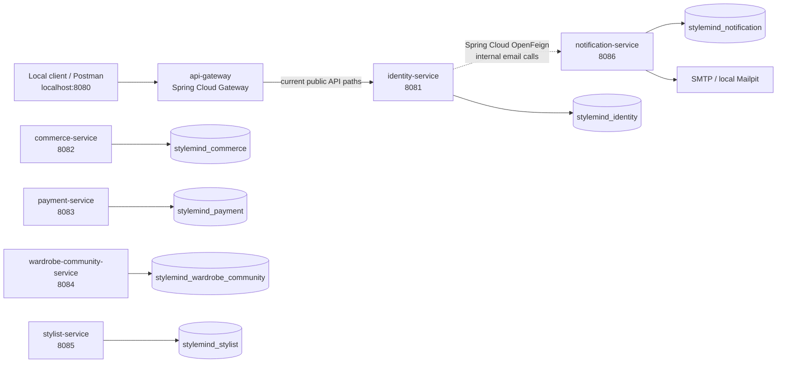

# StyleMind Backend — Service Architecture and Folder Layout

**Purpose:** Give contributors one repository reference for service ownership, the common code-layer convention, and the current source tree of each service.

**Observed local architecture:** working tree as of 2026-10-12. Trees record what exists; a scaffold is not evidence that its business APIs are implemented.

## 1. Architecture at a glance

StyleMind is organized as six independently built Spring Boot business services plus a separate API Gateway application. Each business service owns its logical database and service code. Local client/Postman traffic enters through the Gateway on port 8080; Identity-to-Notification email calls use Spring Cloud OpenFeign on the internal Compose network. The Gateway preserves Identity's existing API paths and does not expose Notification's internal routes.



| Service | Database | Responsibility | Local port |
| --- | --- | --- | ---: |
| `api-gateway` | None | Client-facing routing; no business persistence | 8080 |
| `identity-service` | `stylemind_identity` | Accounts, authentication, Identity-owned profile and address data | 8081 |
| `commerce-service` | `stylemind_commerce` | Catalog, Cart, Checkout and Order | 8082 |
| `payment-service` | `stylemind_payment` | Payment and reconciliation exceptions | 8083 |
| `wardrobe-community-service` | `stylemind_wardrobe_community` | Wardrobe, sharing, community and related chat context | 8084 |
| `stylist-service` | `stylemind_stylist` | AI Stylist sessions, requests and recommendations | 8085 |
| `notification-service` | `stylemind_notification` | Notification delivery | 8086 |

The local PostgreSQL container provisions the six databases; each business service receives credentials for its own database. The Gateway owns no database. Compose publishes only the Gateway at `127.0.0.1:8080`; backend ports stay on the private Compose network. A service must not read or mutate another service's database, and cross-service foreign keys are not used. Cross-service behavior needs an approved API/event contract. The current Identity-to-Notification call uses Spring Cloud OpenFeign for the existing internal email contracts; it carries the service token and does not retry delivery. Production topology and deployment are TBD; this local diagram is not a production design.

The repository uses Java 21 and Spring Boot 3.5.16. Business services use Spring MVC REST and Spring JDBC. The Gateway is a separate Spring Cloud Gateway WebFlux application. Each application has its own Maven `pom.xml`, entry point, configuration and tests. Identity currently has the most complete business feature structure. Notification has its email-delivery feature. Commerce, Payment, Wardrobe Community and Stylist currently contain application/security/observability scaffolding rather than completed business APIs; no Gateway routes for business APIs in those services are invented before those APIs exist.

## 2. Request and persistence layers

For an HTTP feature that reads or writes its service's database, follow this flow:

```text
HTTP request
    -> Controller (route, HTTP status, request/response DTOs)
    -> Service (use case, business rules, transaction boundary)
    -> Repository (Spring JDBC SQL and row mapping)
    -> The owning service's database
```

The response travels back through the service and controller as a response DTO. Keep SQL and row mapping in repositories; keep transaction orchestration and business rules in services; keep controllers focused on HTTP. Use Spring JDBC and existing service conventions rather than introducing JPA or a second persistence framework.

Not every service needs every layer immediately. Notification's current email-delivery routes use Controller → Service → SMTP and have no repository package. The four business-service scaffolds do not yet have business Controller, Service, Repository or DTO packages. Add packages when a scoped feature needs them; do not create empty packages or copy Identity features into another service.

For a new database-backed API, place the feature classes in the owning service's existing responsibility packages. This is a placement example, not a claim that these classes already exist in the scaffolded services:

```text
src/main/java/com/stylemind/<service-package>/
├── controller/<Feature>Controller.java
├── dto/<Feature>Request.java
├── dto/<Feature>Response.java
├── model/<Feature>CommandOrView.java       # when an internal model is useful
├── repository/<Feature>Repository.java
├── service/<Feature>Service.java
└── validation/<Feature>Validator.java      # when validation needs a separate class

src/test/java/com/stylemind/<service-package>/
├── <Feature>ServiceTests.java
├── <Feature>HttpTests.java
└── <Feature>PostgresIntegrationTests.java
```

Add only the files and optional model/validator layers the approved feature needs.

## 3. Package responsibilities

| Package | Responsibility |
| --- | --- |
| `controller` | HTTP routes, request binding, status codes and response headers; delegate use cases to services. |
| `dto` | API request/response shapes. Never return password hashes, OTP digests, refresh-token digests or persistence-only values. |
| `service` | Use cases, business decisions and transaction coordination. Call repositories and approved external contracts. |
| `repository` | SQL through Spring JDBC, parameter binding, result mapping and persistence for the owning database only. |
| `model` | Service-local domain, command, criteria, snapshot and read-model types; not an API serialization shortcut. |
| `validation` | Reusable request and field validation where controller annotations alone are insufficient. |
| `errors` | Exception-to-Problem-Details mapping and stable API error codes. |
| `security` | Authentication, authorization and service-specific security configuration. |
| `logging` | Correlation ID and safe request logging. Never log credentials, tokens, OTPs, authorization headers or secrets. |
| `openapi` | Service API metadata and OpenAPI security descriptions. |
| `directory` / `config` | Service-specific reference data or Spring bean configuration, only when required. |

Tests belong under `src/test/java` in the matching service package. Use unit tests for isolated rules, HTTP/security tests for route behavior, and disposable PostgreSQL integration tests for SQL and transaction behavior. Do not use persistent local data as test cleanup material.

## 4. Current source trees

These compact trees reflect the current local package layout. `...` means multiple files exist; it is not an instruction to add every package to every service.

### `identity-service`

```text
identity-service/
├── .dockerignore
├── Dockerfile
├── README.md
├── pom.xml
└── src/
    ├── main/
    │   ├── java/com/stylemind/identity/
    │   │   ├── IdentityServiceApplication.java
    │   │   ├── client/notification/ # Notification HTTP adapter
    │   │   │   └── payload/         # Private dispatch payloads; not API DTOs or domain models
    │   │   ├── controller/       # auth, profile, address, users, jwks
    │   │   ├── directory/        # pinned Vietnam administrative reference data
    │   │   ├── dto/              # request/response DTOs grouped by feature
    │   │   ├── errors/
    │   │   ├── logging/
    │   │   ├── model/            # JDBC/use-case values grouped by feature
    │   │   ├── openapi/
    │   │   ├── repository/       # concrete Spring JDBC repositories by feature
    │   │   ├── security/
    │   │   ├── service/          # feature interfaces and impl/ + internal/ beans
    │   │   └── validation/       # common, auth, profile, address, users
    │   └── resources/
    │       ├── application.properties
    │       ├── data/vietnam-administrative/
    │       └── db/migration/     # applied Identity V1–V3; do not edit
    └── test/
        ├── java/com/stylemind/identity/
        │   ├── ... unit, HTTP and PostgreSQL integration tests
        │   └── directory/
        └── resources/db/verify-identity-schema.sql
```

### `api-gateway`

```text
api-gateway/
├── Dockerfile
├── pom.xml
└── src/
    ├── main/
    │   ├── java/com/stylemind/gateway/ApiGatewayApplication.java
    │   └── resources/application.properties # Identity public paths; no internal Notification route
    └── test/java/com/stylemind/gateway/GatewayRoutingTests.java
```

The current route forwards `/api/**`, `/.well-known/jwks.json`, and `/v3/api-docs` to Identity without path rewriting. Identity remains responsible for its JWT and role policy. Gateway health is local at `/actuator/health`; no API key/JWT policy is duplicated at the Gateway.

### `commerce-service`

```text
commerce-service/
├── .dockerignore
├── Dockerfile
├── pom.xml
└── src/
    ├── main/
    │   ├── java/com/stylemind/commerce/
    │   │   ├── CommerceServiceApplication.java
    │   │   ├── errors/
    │   │   ├── logging/
    │   │   ├── openapi/
    │   │   └── security/
    │   └── resources/application.properties
    └── test/java/com/stylemind/commerce/CommerceServiceApplicationTests.java
```

Current scaffold only: no business controllers, services, repositories or migrations are present.

### `payment-service`

```text
payment-service/
├── .dockerignore
├── Dockerfile
├── pom.xml
└── src/
    ├── main/
    │   ├── java/com/stylemind/payment/
    │   │   ├── PaymentServiceApplication.java
    │   │   ├── errors/
    │   │   ├── logging/
    │   │   ├── openapi/
    │   │   └── security/
    │   └── resources/application.properties
    └── test/java/com/stylemind/payment/PaymentServiceApplicationTests.java
```

Current scaffold only: no business controllers, services, repositories or migrations are present.

### `wardrobe-community-service`

```text
wardrobe-community-service/
├── .dockerignore
├── Dockerfile
├── pom.xml
└── src/
    ├── main/
    │   ├── java/com/stylemind/wardrobecommunity/
    │   │   ├── WardrobeCommunityServiceApplication.java
    │   │   ├── errors/
    │   │   ├── logging/
    │   │   ├── openapi/
    │   │   └── security/
    │   └── resources/application.properties
    └── test/java/com/stylemind/wardrobecommunity/WardrobeCommunityServiceApplicationTests.java
```

Note the Java package name `wardrobecommunity` (without hyphens). Current scaffold only: no business controllers, services, repositories or migrations are present.

### `stylist-service`

```text
stylist-service/
├── .dockerignore
├── Dockerfile
├── pom.xml
└── src/
    ├── main/
    │   ├── java/com/stylemind/stylist/
    │   │   ├── StylistServiceApplication.java
    │   │   ├── errors/
    │   │   ├── logging/
    │   │   ├── openapi/
    │   │   └── security/
    │   └── resources/application.properties
    └── test/java/com/stylemind/stylist/StylistServiceApplicationTests.java
```

Current scaffold only: no business controllers, services, repositories or migrations are present.

### `notification-service`

```text
notification-service/
├── .dockerignore
├── Dockerfile
├── README.md
├── pom.xml
└── src/
    ├── main/
    │   ├── java/com/stylemind/notification/
    │   │   ├── NotificationServiceApplication.java
    │   │   ├── controller/       # internal email-delivery HTTP routes
    │   │   ├── dto/
    │   │   ├── errors/
    │   │   ├── logging/
    │   │   ├── openapi/
    │   │   ├── security/
    │   │   └── service/          # SMTP delivery
    │   └── resources/application.properties
    └── test/java/com/stylemind/notification/
        └── ... HTTP security, sender and application tests
```

Notification's current email-delivery feature has no repository package. It does not own or store Identity challenge state.

## 5. Adding a feature consistently

1. Confirm the story's owning service, approved contract, database/model and existing security rules before coding. The backlog identifies work but does not approve missing business behavior.
2. Add the feature to its owning service only. Keep that service's database boundary; do not add cross-service SQL or foreign keys.
3. For a database-backed HTTP use case, implement Controller → Service → Repository with Spring MVC and Spring JDBC. Put request/response types in `dto`; use service-local model types for data crossing internal layers.
4. Add only the packages and configuration needed by the feature. Keep SQL in Repository and transaction/business orchestration in Service.
5. Add tests alongside the code under `src/test/java`; add PostgreSQL migrations only for an explicitly approved schema scope. Identity V1–V3 are applied and immutable.
6. Verify with `mvn -f <service>/pom.xml verify` and update the owning service README, Postman collection/run guide for HTTP stories, and this tree if the persistent folder layout changes.

## 6. Related references

- [Current project context](../governance/CURRENT_PROJECT_CONTEXT.md) — service boundaries and source-role rules.
- [Current business rules](../governance/CURRENT_BUSINESS_RULES.md) — owner-confirmed behavior.
- [Open implementation decisions](../governance/OPEN_IMPLEMENTATION_DECISIONS.md) — unresolved decisions.
- [Root README](../../README.md) — local build, run, port and Compose guide.
- [Six-service data model](../../database/six-service-model/ALL_DATABASES.md) — logical data ownership models.
