# EP-07 — Workflow và use flows

**Historical flow proposal:** Owner Prompt 08 (2026-10-29) supersedes all slot examples below for current Stylist work. The active rule is exactly one women’s TOP plus one BOTTOM per outfit; ONE_PIECE, SHOES, ACCESSORY and other slots are excluded. P03-A scope/evidence is in [its handover](EP-07_P03A_SESSION_HISTORY_REPORT.md); other flow behavior remains proposed until separately authorized.


Revision **2026-10-27**. Tất cả hành vi Stylist bên dưới là **PROPOSED — NOT APPROVED**, trừ nơi ghi OBSERVED/existing. Diagram labels dùng English; diễn giải dùng tiếng Việt. Xem [contract](EP-07_PHASE_A_CONTRACT_MEMO.md), [dependencies](EP-07_DEPENDENCY_CONTRACTS.md), [technical design](EP-07_TECHNICAL_DESIGN.md). Mũi tên thể hiện lời gọi/data flow, không phải FK xuyên database.

## 1. Workflow khách hàng

Khách đã đăng nhập mở tư vấn, nhập dịp/phong cách/ngân sách/điều cần tránh. Backend đọc profile khi được yêu cầu, tìm variant phù hợp, ghép các bộ hợp lệ, nhờ model chọn/giải thích, kiểm lại nguồn trước khi lưu kết quả. Khách xem, gửi yêu cầu mới để chỉnh lại, hoặc chủ động lưu một bộ. Tạo gợi ý không mua hàng, không trừ tồn kho, không tạo Order/Payment.

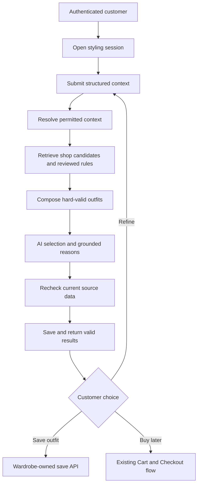

Owned-garment context là target dependency, chưa có producer. Shop-only generation là slice có thể xây trước, **không tự thay mixed-source acceptance**. Nếu khách yêu cầu owned context mà producer chưa hỗ trợ, không lặng lẽ bỏ context đó rồi trả thành công.

## 2. Sequence kỹ thuật tổng

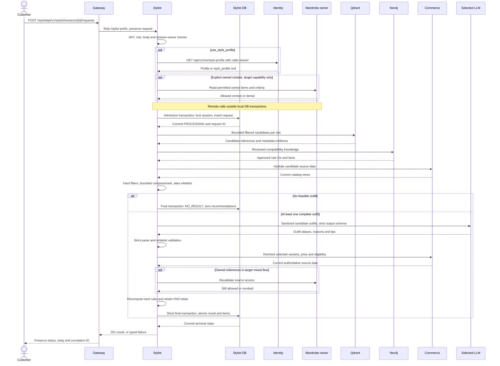

Lỗi sau admission: chuyển PROCESSING→FAILED bằng transaction ngắn khi có thể. Lỗi final write không xóa admission đã commit. Nếu DB unavailable, status có thể còn PROCESSING; không giả rollback toàn bộ request. Không giữ khóa/connection trong lúc gọi model/Feign/retrieval.

## F01 — Tạo session và xem lịch sử

**Actor/trigger:** customer mở trang tư vấn. Input POST session `{}` hoặc title; owner lấy từ JWT, không từ body. Precondition JWT hợp lệ và role cho phép. Output proposed 201 session; GET messages owner-scoped trả page lịch sử, không ghi dữ liệu.

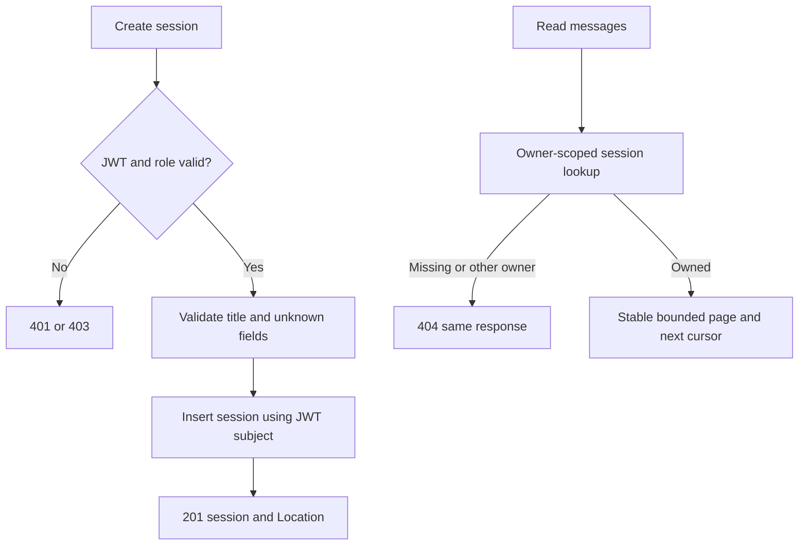

Data: STYLIST_SESSION, STYLIST_MESSAGE; source-message links từ request batch lookup. Test empty history, same timestamp tie, không page trùng, A không xem B, cursor invalid/cross-session, HEAD không ghi. Không tạo close/delete/title-edit endpoints chỉ vì model có closed_at/title.

## F02 — Nhận request và resolve context

**Input:** session ID, manual context, structured budget/exclusions, optional profile, optional explicit target-owned refs. Validate local owner trước đọc private remote context. Explicit scalar/null thắng saved requirement được chỉ định; profile chỉ là soft preferences. Budget/hard exclusions phải ở structured fields, không suy từ câu chat rồi tự áp dụng.

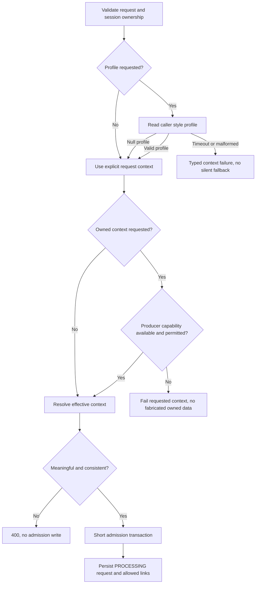

Profile absent hợp lệ; profile service outage khác absent. Unknown soft code cảnh báo/ignore riêng giá trị theo contract; unknown hard code phải được xử lý rõ. Identity hiện có weight_kg, nhưng proposed data minimization không gửi cân nặng/chiều cao mặc định ra model. Saved Wardrobe requirement chưa có API/bảng physical. Test precedence/null/[]/unknown/foreign source_message, malformed profile, permission denied, no DB write on preflight error.

## F03 — Retrieval có nguồn và giới hạn

**Trigger:** context hợp lệ và request admitted. Qdrant dùng embedding tìm shop candidates theo slot; Neo4j trả tri thức đã review. Các store là projection, không quyết giá/quyền. Hydrate Commerce trước khi dùng candidate. Metadata product/category/brand hard rules cần source có đủ thuộc tính, internal batch một mình chưa đủ.

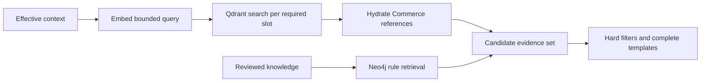

Không một global top-K toàn áo rồi gọi “không có quần phù hợp”. Slot mapping phải được curate; tên category không tự trở thành ontology. Không index private owned items chung với shop catalog. Empty dataset/insufficient candidates khác retrieval outage. “NO_RESULT” là không có bộ trong tập ứng viên đã xét, không chứng minh toàn shop không có bộ nào. Sample product pagination không phải consistent full export. Test Recall@K theo slot, inactive, missing metadata, draft knowledge, mismatch model/dimension và outage hai stores.

## F04 — Ghép và xếp hạng bằng code

**Input:** candidate whitelist + mapped context/rules. Templates đề xuất TOP+BOTTOM hoặc ONE_PIECE; không có optional slot. Selected owned anchors chỉ áp dụng nếu được owner duyệt và có producer đúng. Pure engine không gọi network, không ghi DB.

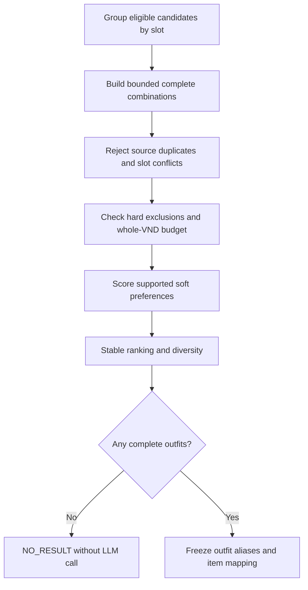

Giá mỗi bộ là tổng SHOP_VARIANT, quantity implicit 1; OWNED_WARDROBE hợp lệ có cost 0. Shop variant nằm trong outfit đã lưu vẫn là shop item, không cost 0. Hard amount=900000 chấp nhận total=900000, reject 900001; không float/round/overflow. Optional accessories cũng tính vào budget. Soft budget chỉ rank; không tự chuyển hard. Weights/caps ở memo là đề xuất cần benchmark. Test insufficient slot, zero/exact/+1/overflow, duplicate, no combinatorial explosion, tie-break reproducible.

## F05 — LLM chọn và diễn đạt

**Input:** một tập hữu hạn outfit đã hard-valid, aliases như O1/O2 và item aliases, evidence text/rule IDs tối thiểu. LLM chỉ chọn outfit alias và tạo reasons/tips; không đổi composition, sinh product ID, giá, URL hoặc gọi tools. Code map aliases về typed IDs gốc.

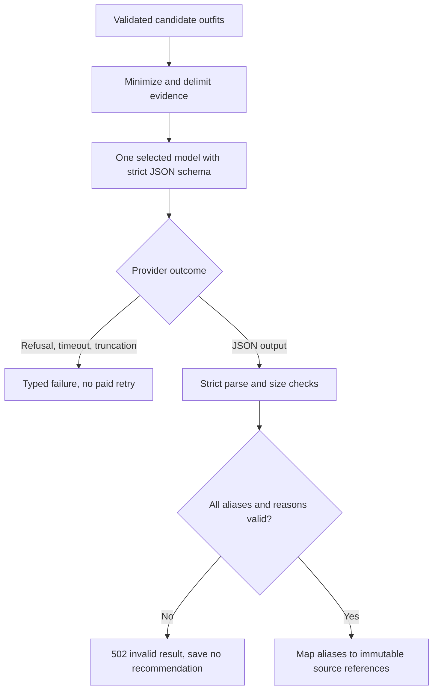

Proposed output example (runtime-only aliases):

```json
{"outfits":[{"outfit_alias":"O1","explanation":"Phù hợp tiêu chí màu đã chọn.","styling_tips":null,"item_reasons":[{"item_alias":"I1","reason":"Khớp màu trung tính trong metadata."},{"item_alias":"I2","reason":"Bổ sung slot còn lại theo template."}]}]}
```

Schema enforce shape; validator enforce alias membership, uniqueness, complete item reasons and forbidden price/name/URL fields. Free-text factual claims vẫn cần evidence/human quality review; JSON không loại hết hallucination. Nếu provider giảm số kết quả, trả fewer theo contract, không bù bằng fabricated outfit. Không gửi email/JWT/full history/raw private images; user/catalog/knowledge text đều là untrusted data. Model choice tại technical design là đề xuất benchmark, không production approval.

## F06 — Final checks và atomic save

**Trigger:** output model parse được và aliases hợp lệ. Mọi outfit qua authoritative Commerce checks; target mixed flow còn Wardrobe access recheck. Không dựa giá Qdrant hoặc giá model trả về.

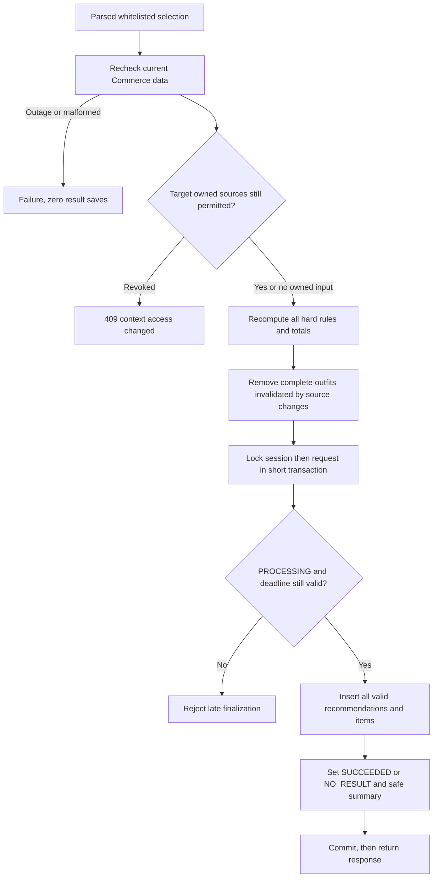

Provider structural/whitelist violation reject **toàn output**; price/status đổi sau output hợp lệ có thể loại từng complete outfit theo memo. Ví dụ 320000+450000=770000 ban đầu; giá sau đổi thành 500000+450000=950000, hard900000 → không lưu bộ đó. Tối đa bound/deadline còn lại, không tự lặp model để chữa lỗi. Nonempty recommendation aggregate; insert item failure rollback cả result batch. Không distributed atomicity với Commerce/Wardrobe: chỉ cam kết đã check tại lần đọc, không price lock hay revoke linearizability xuyên service.

## 3. State và recovery — thuộc F06

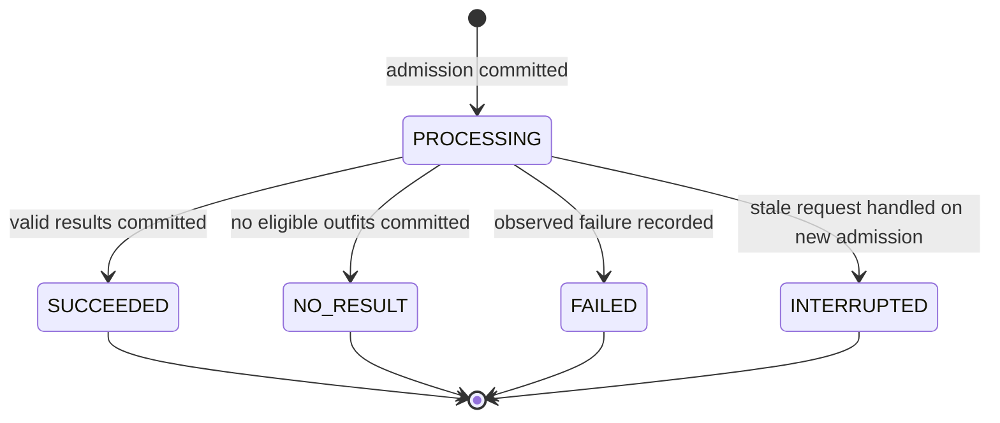

Vocabulary này **chưa được duyệt**, chưa có Stylist migration. Runtime deadline và requested_at admission-age khác nhau; chưa có deadline column. Không resume AI sau crash để tránh bill lặp. Fault recording có thể thất bại khi DB down. GET chỉ đọc state, không sửa stale rows; new admission mới xử lý stale under lock theo proposal. Duplicate sequential POST tạo request mới; không hứa idempotency/exactly-once billing. Structured-only request bị mất response chưa có list-requests endpoint để discover chắc chắn: đây là gap, không giấu trong content.

## F07 — Đọc result và lịch sử an toàn

**Input:** owner JWT + request/recommendation ID. Local owner-join trước remote calls; nếu có owned private refs phải revalidate trước trả explanation/item names. Catalog data được hydrate hiện tại; không replay historical price.

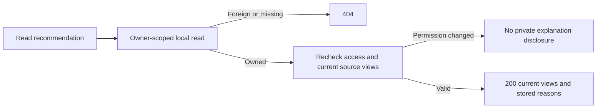

Missing/inactive shop source có availability unavailable, historical ID giữ lại, current total null nếu không tính đủ. Source outage trả typed failure, không giả inactive. Không gọi provider hoặc tạo row khi GET. Lịch sử chat chứa USER content cũng có thể nhắc đồ private: read permission policy/history redaction phải được chốt, không chỉ chặn recommendation rồi vẫn leak qua message. Test B đổi IDs, revoked source, source disappeared, GET/HEAD no writes, source counts bounded, no price-snapshot claim.

## F08 — Refine bằng request mới

Khách gửi context và hard constraints mới trong cùng session. Proposal không kế thừa âm thầm budget/constraints của request trước; client muốn giữ phải gửi lại structured values. “Rẻ hơn” trong chat chưa phải amount/hard flag. Không sửa kết quả cũ, không tự thêm parent_request_id hoặc locked-item feature.

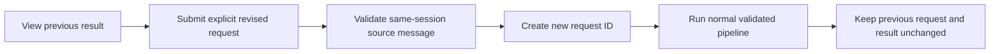

Test source message từ session khác, omitted/null budget semantics, constraints full replacement, same content repeated/no-idempotency, same-session admission race. Nếu cần conversational inheritance/lineage, chốt contract/model delta trước, không dùng LLM memory tự sửa hard constraints.

## F09 — Save Outfit, share và Cart handoff

**OBSERVED:** Wardrobe POST `/api/v1/me/outfits` nhận `name`, `creation_source`, `items:[{variant_id}]`, 1–10 unique variants; caller-owned, current purchasability check. Không nhận wardrobe_id/source_recommendation_id/owned provenance/slots. creation_source=AI là label client gửi, chưa phải verified AI recommendation provenance.

Wardrobe `/me/outfits` và `/me/shared-outfits` hiện yêu cầu `ROLE_CUSTOMER`. ADMIN-only JWT có thể được cho dùng Stylist theo proposal nhưng chưa được save qua Wardrobe; không tự cấp CUSTOMER role hoặc sửa producer authorization để làm flow xanh.

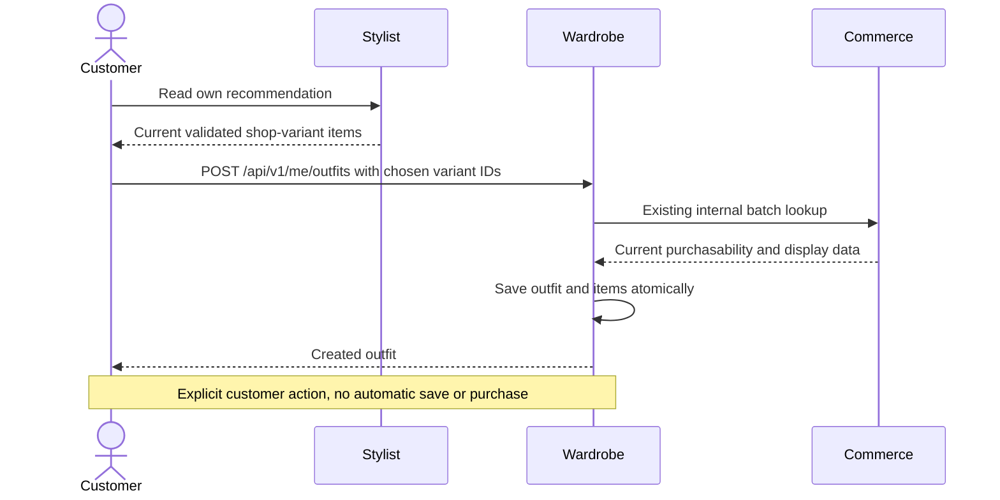

Body existing (synthetic ID):

```json
{"name":"Bộ đi làm","creation_source":"AI","items":[{"variant_id":"30000000-0000-4000-8000-000000000001"}]}
```

Đường này hỗ trợ save shop result với code hiện có; không chứng minh source recommendation link hoặc owned context đã hoàn thành. Save mixed result cần producer contract/schema khác, team owner phải duyệt. Share by email/public link dùng Wardrobe API hiện hữu sau save; Stylist không thêm friend graph/chat/notification. Buy là user chuyển variant tới Cart; không tạo Payment từ AI. Test fresh eligibility/save ownership, duplicate click behavior, rejection old/inactive variant, mixed refs không cast thành variant IDs.

## F10 — Đồng bộ catalog projection

**Trigger target:** Commerce catalog event được producer xác thực, version tăng đơn điệu theo aggregate. Hiện PaymentConfirmed delivery tồn tại nhưng không phát catalog changes. Product list paging không thay full consistent snapshot.

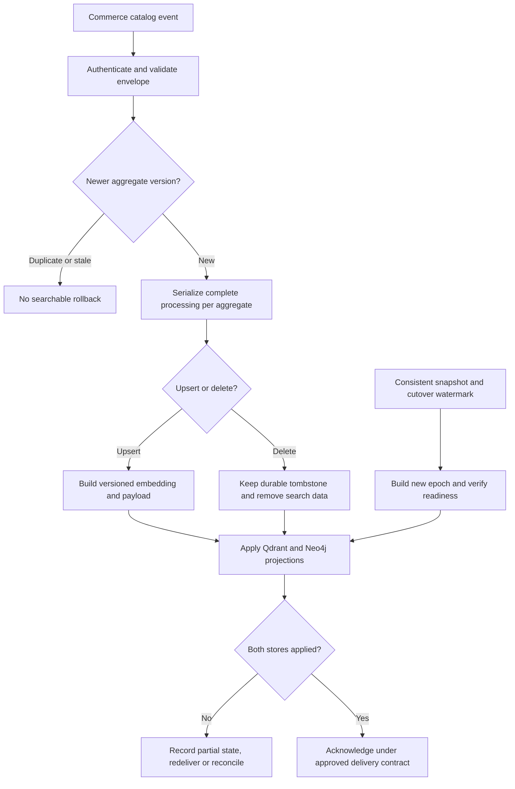

Delayed embedding v42 không được overwrite v43. Point xóa không được làm mất high-water tombstone. Hai stores không có chung transaction; cần per-target durability/recovery và producer snapshot/cutover contract trước live R99. Transport/broker/coordinator schema chưa được duyệt; không tự thêm Kafka/RabbitMQ/inbox/outbox hoặc mượn Payment ledger. Test duplicate, same-version different-content, stale after delete, product/category/brand fanout, one-store down, restart/redelivery, epoch/rebuild race.

## 4. Dùng tài liệu này khi code

Mỗi flow phải map task → approved rule → DTO/model field → owner/transaction/side effect → negative/concurrency tests → evidence level ở [verification matrix](EP-07_VERIFICATION_MATRIX.md). Đồ thị là thiết kế đề xuất, không bằng chứng code chạy. Thay đổi business rule phải cập nhật contract/flow/tests cùng slice; chỉ đổi sơ đồ không phải approval.

## Wave 2 runtime sequence — implementation scope (2026-11-05)

This sequence records the approved generation/read slice. Owned context, Identity profile, catalog events, production Commerce policy and live-provider calls are not part of the implemented flow.

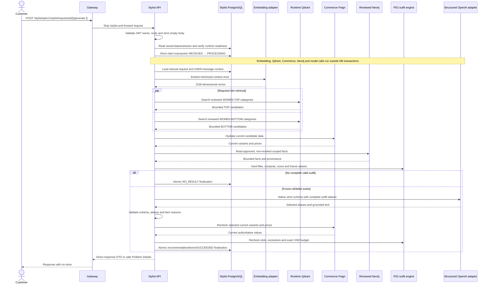

Any error after claim is recorded as `FAILED` in a separate short transaction when storage is available. If the DB cannot record failure, `PROCESSING` may remain; there is no automatic recovery worker or startup reset.
