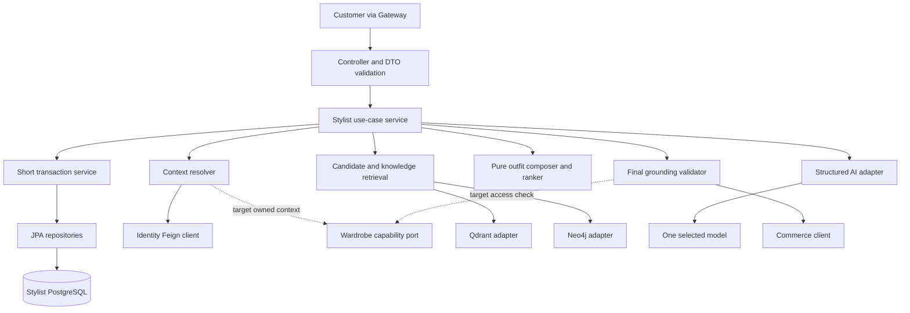

# EP-07 — Technical design và model strategy

**Owner persistence decision, 2026-10-28:** Use Spring Data JPA/Hibernate for forthcoming Stylist persistence, superseding previous JDBC instructions. Retain Controller -> Service interface/impl -> Repository. Schema/API/P03 implementation are not approved by this framework decision. Do not refactor other services.


**Historical technical proposal:** Owner Prompt 08 (2026-10-29) supersedes all slot/template examples below for current Stylist behavior. P02 now composes exactly one women’s TOP and one BOTTOM, and rejects ONE_PIECE, SHOES, ACCESSORY and every other slot. P03-A is session/history only; downstream architecture remains proposed.


Revision **2026-10-27**. Thiết kế mới là **PROPOSED — NOT APPROVED**. Đây là phương án để triển khai từng slice, không phải chỉ thị bắt đầu code ngay. Đọc [flows](EP-07_FLOWS.md) và [contract memo](EP-07_PHASE_A_CONTRACT_MEMO.md).

## 1. Kiến trúc đề xuất

Giữ một `stylist-service`. Spring MVC nhận request; service điều phối các bước; engine Java quyết hard rules và ghép outfit; adapters gọi các service/data stores/model. PostgreSQL chỉ lưu dữ liệu Stylist. Qdrant hỗ trợ tìm sản phẩm theo ý nghĩa, Neo4j truy xuất quan hệ/tri thức đã review; cả hai là dữ liệu dẫn xuất. Không tạo một microservice riêng cho từng bước AI.



Solid/dotted không phân biệt đã code; toàn diagram là proposed structure. Dotted chỉ producer capability hiện thiếu. JWT/correlation/deadline đi qua use case, bearer chỉ tới trusted APIs; không đi vào prompt/model.

## 2. Package theo lớp, chia theo chức năng

Owner muốn tìm được login/address/recommendation qua folder thay vì file tràn lan. Giữ MVC layer ở cấp đầu và feature ở cấp sau. Chỉ tạo package/class khi slice cần; tree dưới là target, không scaffold tất cả một lần.

```text
com.stylemind.stylist
├── controller/
│   ├── session/StylistSessionController
│   ├── request/StylingRequestController
│   └── recommendation/RecommendationController
├── dto/
│   ├── session/request/ + session/response/
│   ├── request/request/ + request/response/
│   └── recommendation/response/
├── model/
│   ├── session/ + request/ + recommendation/
│   ├── context/EffectiveStylingContext
│   └── catalog/CatalogVariantView
├── service/
│   ├── session/StylistSessionService + impl/
│   ├── request/StylingRequestService + impl/ + internal/
│   ├── recommendation/RecommendationService + impl/ + internal/
│   │   └── internal/OutfitComposer, BudgetPolicy, GroundingValidator
│   └── knowledge/ + projection/  # only in owning phase
├── entity/session/ + request/ + recommendation/  # only approved persistence slices
├── repository/
│   ├── session/ + request/ + recommendation/
│   └── knowledge/               # only after knowledge schema approval
├── client/
│   ├── identity/ + commerce/ + wardrobe/
│   │   └── payload/             # private remote DTOs, not public API DTOs
│   ├── ai/                      # selected model and embedding adapter
│   ├── qdrant/
│   └── neo4j/
├── validation/session/ + request/ + recommendation/
├── config/                      # bounded limits, scoped client settings
└── security/ + errors/ + logging/ + openapi/

src/main/resources/db/migration/  # approved Stylist migrations only
src/test/java/.../engine/ + http/ + client/ + persistence/ + integration/
src/test/resources/stylist/fixtures/ + evaluation/
```

Controller làm binding/status/header và gọi use case, không ghép đồ/SQL. Public use-case service có interface + impl theo convention team. Pure helper chỉ có một implementation không cần interface/impl hình thức. Repository dùng Spring Data JPA với truy vấn và fetch có giới hạn; model nội bộ không serialize thẳng thành response. Client payload không được lẫn DTO request của API công khai. Transaction helper là Spring bean riêng được gọi qua proxy, không private self-invoked `@Transactional`.

**Persistence policy:** owner explicitly selected Spring Data JPA/Hibernate on 2026-10-28. Retain JPA starter; use feature-grouped entities and repository interfaces, DTO mapping and explicit service transaction boundaries. Bound queries/fetches to avoid N+1; network calls remain outside transactions. Flyway manages approved schema; ddl-auto must not create/update tables. Other services are not refactored. P03 schema/API approval remains separate.

## 3. Vai trò các mô hình và công nghệ

| Thành phần | Làm gì | Đề xuất ban đầu / giới hạn |
|---|---|---|
| LLM generation | Chọn outfit aliases, reasons, styling tips theo evidence | Benchmark `gpt-6-luna` qua một OpenAI adapter; comparator `gpt-5.4-mini-2026-03-17` nếu cần. Chưa chọn production winner hoặc gọi paid API |
| Text embedding | Biến mô tả/query thành vector để semantic search | `text-embedding-3-small` candidate; pin model/dimension/normalization/index epoch sau capability test |
| Qdrant | Lấy bounded candidates theo slot + metadata filters | Official Java client; server/client version pin theo deployment thật |
| Neo4j | Lưu/truy xuất reviewed compatibility facts và provenance | Official Java Driver 6.x candidate, pin exact version sau kiểm server. Không LLM tự tạo luật rồi coi approved |
| Pure Java engine | Budget, exclusions, slot completeness, compose/rank/diversity | Deterministic, unit-testable; không cần train/fine-tune |
| Spring AI | SDK abstraction cho model/embedding, nếu spike đáp ứng | Dùng line 1.1.x cho Boot 3.5.x; pin patch tương thích. Không copy Spring AI 2.x/Boot4 snippets hoặc upgrade platform để cài AI |
| Feign | Internal Identity/Commerce/Wardrobe calls | Scoped config, explicit headers, no redirects/retry; không global token forwarding |
| Flyway/PostgreSQL | Immutable schema versions, local ownership/persistence | Schema từng slice được duyệt; no cross-DB FK, no auto DDL |

Đây là **recommendation để benchmark**, chưa thể gọi “model tối ưu” khi chưa đo dữ liệu thời trang Việt. Không train AI ở giai đoạn đầu: tri thức/rules/catalog được đưa vào lúc inference. RAG giúp cấp nguồn; engine kiểm business; LLM diễn đạt. Không thêm multimodal/image embedding/virtual try-on/body-shape inference chỉ vì model có thể nhận ảnh.

Nguồn official đã đọc ngày 27/10:

- [Spring AI compatibility](https://github.com/spring-projects/spring-ai): 1.1.x cho Boot3.5.x, 2.x cho Boot4.x. Chưa resolve dependency/build repo trong lượt docs.
- [GPT-6 Luna](https://developers.openai.com/api/docs/models/gpt-6-luna): structured outputs; cần capability test đúng endpoint/options/account. Không đoán dated snapshot khi docs chỉ liệt kê alias.
- [GPT-5.4 mini](https://developers.openai.com/api/docs/models/gpt-5.4-mini): comparator có dated snapshot ở trên. Giữ một provider adapter, không automatic fallback.
- [Structured Outputs](https://developers.openai.com/api/docs/guides/structured-outputs): schema không chứng minh facts/business validity; refusal/truncation vẫn cần typed handling.
- [Embeddings](https://developers.openai.com/api/docs/models/text-embedding-3-small), [Qdrant SDKs](https://qdrant.tech/documentation/interfaces/), [Neo4j Java driver](https://neo4j.com/docs/java-manual/current/install/).

Chưa có bằng chứng tài khoản có access/model availability, pricing thực tế theo region/tier, latency hay fashion quality. Trước benchmark owner duyệt budget/data; record model ID/options, SDK version, usage và dataset ở test artifact synthetic. Không thêm version/trace column vào DB chưa duyệt. Astra là coding Agent người dùng chọn, không tự trở thành runtime inference model.

## 4. Engine — từ candidate tới bộ phối

1. **Resolve context:** explicit structured fields/null > requirement được chỉ định (khi có producer) > absent. Profile preferences chỉ soft. Không đọc hoặc upload toàn bộ profile/history.
2. **Map vocabulary:** curated category→slot, color/style aliases→meaning. Unknown soft metadata được bỏ/rank neutral với warning; unknown hard rule không được đoán bằng model. Mapping artifact có revision/reviewer, không tạo taxonomy DB ngoài scope.
3. **Retrieve per slot:** top candidates theo từng slot, gồm current metadata/source. Approximate retrieval có thể bỏ lỡ bộ khả thi; no-result chỉ phản ánh bounded search, không hứa exhaustive catalog.
4. **Hard filter:** sale eligibility, exclusions, valid typed source, selected anchors nếu approved. Chỉ trường có evidence; không coi missing category/style là match.
5. **Compose bounded:** templates TOP+BOTTOM hoặc ONE_PIECE; không optional slots. Proposed cap60 candidates/1000 combinations/3 results/2 items per outfit; benchmark rồi owner duyệt. Bounded beam/top combinations thay vì full Cartesian product.
6. **Score soft:** context3/style2/color2/brand1/soft-budget1/reviewed compatibility3 theo memo proposal. Missing feature=0; tie-break deterministic by sorted typed source IDs. Score không là xác suất “phối đẹp”.
7. **Diversity:** không trả cùng bộ lặp; kết quả khác nhau ở non-anchor item. Nếu chỉ còn một bộ, trả một; không nới hard rule cho đủ count.
8. **Freeze aliases:** O1→complete immutable outfit, I1→typed candidate. LLM chọn O1; không tái ghép slots. Validate returned item reasons đúng exact item set của outfit đã map.
9. **Final grounding:** actual Commerce prices/status/hard attributes + target source permission. Recompute checked integer totals, reject unsafe output, atomic persist valid aggregate.

Budget: `sum(current unit_price_vnd of unique SHOP_VARIANT items)` với quantity1; genuine OWNED_WARDROBE cost0. Exact whole VND, checked addition; hard amount null invalid, exact equality allowed, optional pieces included. Shipping/discount/tax/order total không thuộc công thức. Saved shop outfit không phải genuine owned garment.

## 5. Data contracts và privacy

Public HTTP DTO, remote payload, runtime candidate, persisted model là bốn vai trò khác nhau. Runtime candidate chứa current price/metadata/check time; PostgreSQL model hiện không có snapshot các trường đó. LLM schema chỉ aliases/reasons/tips; backend hydrate response. Không trả `price` do model tạo hoặc URL do model gợi ý.

Proposed provider input: minimized manual styling context, supported soft codes, complete outfit aliases + descriptive evidence đã giới hạn, reviewed knowledge IDs/facts. Không JWT/service token/account UUID/email/phone/password/OTP/private key/raw image/full body measurements. Nếu user free text chứa PII, cú pháp whitelist/redaction không chứng minh đã loại hết PII; real-user external processing cần owner data policy/consent. Shared/public visibility không tự cấp consent.

No full prompt/response logging. Log correlation, phase, duration, safe error code, bounded counts/usage không content. Typed client exceptions không giữ raw body trong safe log. Không exception stack từ SDK vô tình in authorization/provider payload. Offline fixtures không raw customer data; generated aliases không identity authorization.

## 6. Relational model và transaction design

Giữ **9 target entities** trong model; attribute-by-attribute mapping ở memo mục6. Chưa có Stylist business migration. R93:5 tables; R97:2; 2 knowledge tables là scope review riêng, không tự gộp vào R93.

| Aggregate | Tables | Invariants chính / gap |
|---|---|---|
| Conversation/request | STYLIST_SESSION, STYLIST_MESSAGE, STYLING_REQUEST, STYLING_CONSTRAINT, REQUEST_WARDROBE_ITEM | Owner join qua session; source message cùng session; constraints XOR; remote owned refs chưa producer |
| Recommendation | WARDROBE_RECOMMENDATION, RECOMMENDATION_ITEM | Result nonempty, complete template, source XOR, unique order/source, atomic write; không price snapshot |
| Knowledge | KNOWLEDGE_SOURCE, KNOWLEDGE_ENTRY | Source provenance, reviewed states; ingestion/reviewer decision riêng; không arbitrary crawler |

Admission transaction lock session trước request; finalization giữ cùng lock order. Không transaction qua Feign/Qdrant/Neo4j/model. Request status vocabulary proposed PROCESSING/SUCCEEDED/NO_RESULT/FAILED/INTERRUPTED. Fault recording separate short transaction; schema chưa lưu error details/deadline/idempotency/provider trace, không nhét chúng vào text.

Proposed synchronous bounded execution tổng30s từ HTTP entry; runtime deadline bao gồm preflight/context. requested_at chỉ admission time; không bằng HTTP entry deadline. Timeout/DB commit ambiguity có thể khiến response fail dù row đã commit; client đọc lại request nếu biết ID, không auto repeat paid POST. Stale admission handling và request discoverability còn decision ở memo, không giả background worker đã có.

## 7. Events/projections và giới hạn vận hành

Commerce catalog event cần aggregate ID/version/schema/source/auth, full snapshot/upsert/delete semantics và snapshot watermark. Payment outbox/inbox chỉ chuyển PaymentConfirmed, không cấp catalog publisher hoặc monotonic catalog versions. Không thêm broker/inbox/outbox theo suy luận từ team Payment.

Stylist-owned projections giữ model/dimension/epoch/source version, durable delete high-water và per-store readiness. Read-then-upsert không là atomic CAS; delayed embeddings cần serialization/fence đủ qua restart/replicas. Hai stores không chung commit; partial apply phải repair trước claiming healthy. Coordinator schema/transport/durability cần explicit design approval.

Start nhỏ: offline curated dataset → disposable Qdrant/Neo4j → selected-provider benchmark → live source contracts → Gateway. Branch tách biệt chỉ cô lập Git, không cô lập PostgreSQL volumes/provider billing/shared indexes. Docker tests dùng project/volume/collection/database names riêng và exact cleanup inventory; không `down -v` vào stack chung.

## Wave 2 implementation responsibility map — 2026-11-05

| Step | Main classes | Responsibility and boundary |
|---|---|---|
| HTTP/security | `StylistGenerationController`, `SecurityConfiguration`, `SessionRequestPolicyFilter`, `GenerateRequestParser` | JWT role/owner subject, strict `{}` generation body, route/method policy, no-store, direct DTO/Problem Details |
| Orchestration | `StylistGenerationService`, `StylistGenerationServiceImpl` | One generation attempt, deadline, input preparation, retrieval/engine/model/final check ordering; no DB transaction during remote calls |
| Lifecycle persistence | `GenerationPersistenceService`, `GenerationPersistenceServiceImpl`, `StylingRequestRepository`, `StylistSessionRepository` | Owner reads, lock order, claim, terminal replay, atomic recommendation aggregate, conditional failure recording |
| Deterministic rules | `OutfitEngine`, `CandidatePolicy`, `BudgetPolicy`, `OutfitComposer`, `OutfitScorer`, `ResultDiversity`, `OutfitWhitelist` | Women’s TOP+BOTTOM hard validation, exact VND, bounded composition/ranking, immutable model aliases |
| Reviewed catalog | `ReviewedCatalogPolicy`, `RuntimeCatalogImportRunner`, `CommerceCatalogClient`, `CommerceCatalogFeignClient` | Explicit category mapping, bounded operator import from Commerce APIs, current metadata and final price recheck |
| Embedding/vector | `OpenAiRuntimeEmbeddingAdapter`, `RuntimeQdrantVectorStore`, `RuntimeEmbeddingPort`, `RuntimeCandidateSearch`, `CandidateRetrievalServiceImpl` | Exact embedding model/dimension validation, separate cosine runtime index, slot-filtered retrieval, no fixture aliasing |
| Knowledge | `ReviewedKnowledgeService`, `Neo4jReviewedKnowledgeService`, `KnowledgeArtifactImporter` | Fixed parameterized queries, reviewer/source/status/revocation checks, bounded evidence, explicit artifact import |
| LLM | `StructuredRecommendationModel`, `OpenAiStructuredRecommendationModel`, `OpenAiModelConfiguration` | One approved model; actual native strict JSON Schema; parse refusal/truncation/aliases/reasons; no retry/fallback/tools |
| Aggregate mapping | `RecommendationMapper`, recommendation DTOs/entities/repositories | Map frozen backend IDs and model explanations into two-item persistence; no provider price/URL ownership |
| Errors/config | `ErrorCode`, `StylistApiException`, `ApiExceptionHandler`, `application.properties` | Stable safe HTTP errors, externalized deadlines/dependencies/model settings, default provider calls disabled |

This map describes current code responsibilities. It does not claim that the live Commerce catalog, production knowledge artifact, provider entitlement, Gateway route or fashion quality has been validated.
